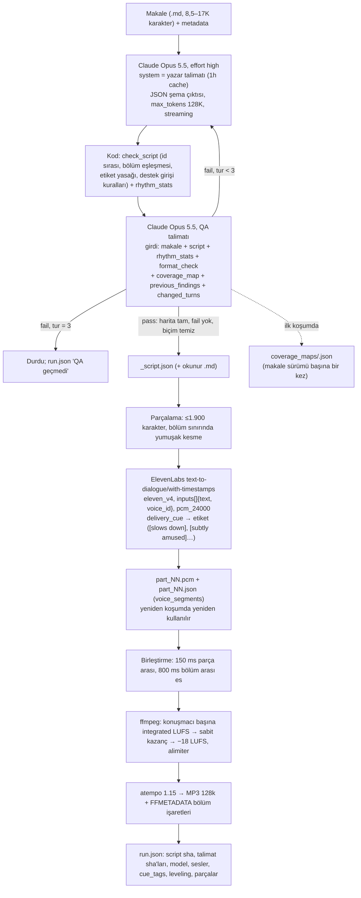
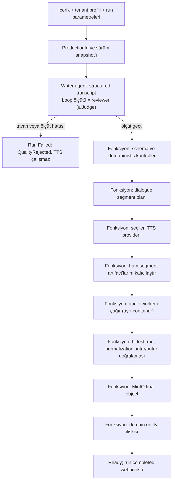
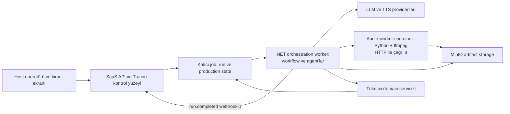

# Tracon — Podcast üretimi için tüketici uyum raporu

**Tarih:** 13 Ekim 2026 (dördüncü değerlendirme). Bu belge önceki sürümlerin
yerine geçer; dosya adı bağlantılar bozulmasın diye ilk yazım tarihini taşır.

**İnceleme zemini:** Tracon `55272673` ve aynı günün commit edilmemiş işi.
Faz 195 (düğüm düzenleme ve fonksiyon düğümü ayarı) 2026-10-12'de kapandı;
K-903…K-911 commit edildi (`842d126a`). 2026-10-13'te bu ölçümün ardından
dört kusur kapandı (F-383, F-384, F-385, F-388; K-912, K-913), F-296 Faz
203'e, F-320 ile F-346 Faz 204'e, F-405 Faz 196'ya girdi. Faz 196…204
planlandı, plan onayı bekliyor. Tüketici reposu `PodcastUretimHatti`, dal `uretim/oyak-12-makale`,
`89251e2` artı commit edilmemiş 12–13 Ekim koşumları; aynı projenin video hattı
`Explainer-Video` hâlâ tek commit `edb560a`.

**Yöntem:** Tüketici reposunun kodu, talimatları, karar dosyası ve pilot
koşum kayıtları okundu; on bir script koşumunun (sekizi tamamlandı, 42 model
çağrısı) ve yedi ses koşumunun `steps.json`/`run.json` kayıtları ile dosya
zaman damgaları ölçüldü (§ 2.2). Seri bu oturum sırasında koşmaya devam etti. Tracon tarafı kodla doğrulandı: harness `Loop` ve `aiJudge`
(MAF 1.20.0 XML belgesi), Anthropic sağlayıcısı ve SDK 12.39.0, ses
sözleşmesi, workflow ve zamanlama varsayılanları.

**Kapsam:** Tüketicinin bugünkü hattı, mevcut Tracon yeteneklerinin uyumu ve
öncelikli geliştirme önerileri. Bu belge bir faz planı değildir. Tracon
üzerinde gerçek koşum yapılmadı; tüketici sayıları tüketicinin kendi
kayıtlarından gelir ve bu oturumda yeniden üretilmedi. Süre değerleri dosya
zaman damgasından türetilmiştir; aynı dakikada başlatılan paralel koşumlar
birbirini yavaşlatmış olabilir.

**İlişkili kayıtlar:** [keşif kaydı](../../kesif/2026-10-11-podcast-tuketici.md) ·
kapanan [Faz 195](../fazlar/195-WORKFLOW-DUGUM-DUZENLEME-VE-AYAR.md) ·
planlanan fazlar [196](../../196-UZUN-ADIM-SURE-VE-IPTAL.md) ·
[197](../../197-DAYANIKLI-WORKFLOW-YURUTMESI.md) · [198](../../198-ADLI-KONUSMA-SAGLAYICISI.md) ·
[199](../../199-FONKSIYON-DUGUMU-MALIYETI.md) · [200](../../200-WORKFLOW-SURUM-GECMISI-VE-SABITLEME.md) ·
[201](../fazlar/201-LOOP-DUZENLEME-VE-OLCUT-FABRIKASI.md) · [203](../../203-COK-KONUSMACILI-DIYALOG-SENTEZI.md) ·
[204](../../204-KESILEN-CIKTI-VE-ANTHROPIC-AYARLARI.md) · [ADAYLAR](../../ADAYLAR.md) (F-297,
F-406, F-407, F-411, F-412, F-417) · aynı tüketici projesinin
[explainer video raporu](2026-10-11-explainer-video-tuketici-uyum-raporu.md).
İki hat aynı host'ta, aynı kiracı ekranından başlar; video raporunun sandbox
modeli (§ 7.3), kusur tabloları (§ 12) ve yol A/C ayrımı (§ 8) burada
tekrarlanmaz.

## 1. Sonuç

**Bu senaryo Tracon üzerine kurulabilir. Mevcut paketler bütün podcast hattını
hazır olarak sunmaz.** Tüketicinin hattı 13 Ekim itibarıyla çalışan bir
prototiptir: iki Python script'i, Claude Opus 5.5 ile yazar + ayrı QA
çağrısı, ElevenLabs Text to Dialogue ve ffmpeg (§ 2.1). 12 makalelik serinin
yedisi ve v7 QA'dan geçti, yedisi seslendirildi; seri 13 Ekim gecesi koşmaya
devam ediyordu. Hat bir .NET uygulaması değildir; Tracon'a
taşınacak olan bu prototipin **düzenidir**, kodu değil.

Önerilen yapı değişmedi: host'un yönettiği, tenant'a göre ayarlanan bir
workflow. Writer agent'ı ilk adımdır; QA bu agent'ın harness `Loop`
ölçütüdür; TTS, audio işleme ve domain kaydı deterministic fonksiyon
düğümleridir; run başına değişenler workflow parametresidir (Faz 194); düğüm
başına ayar Faz 195 ile geldi.

Ölçüm, boşlukların sırasını değiştirdi. Bu tüketicide en belirgin Tracon
boşlukları şunlardır:

1. **QA ölçütü veriyle tanımlanamaz.** Tüketicinin QA'sı ayrı bir talimat,
   kendi JSON şeması (kapsam haritası, kategorili bulgu, replik numarası),
   kodla hesaplanan ritim istatistiği ve biçim kontrolü, makale sürümü başına
   saklanan kapsam haritası taşır. Tracon'un `aiJudge` ölçütü yalnız ölçüt
   listesi ve talimat alır; yargıç sabit bir `{answered, gapAnalysis}`
   kararı verir ve host'un tek yargıç modelinde koşar (§ 4). Bu QA ancak
   Faz 201'in kodla kayıtlı reviewer deseniyle (F-301) kurulur.
2. **Varsayılan süre ve çıktı sınırları ölçülen değerlerin altındadır.**
   Writer çağrısı 1,2–5,8 dk sürdü ve 48.172 çıktı token'ına çıktı;
   `AgentGraph.ChildDeadline` 2 dk, Anthropic `DefaultMaxOutputTokens`
   4.096, `RunTimeout` 10 dk (§ 10). Hepsi kurulumda yükseltilir; agent
   düğümü başına süre ve tanım başına `RunTimeout` Faz 196'ya (F-405),
   kesilen çıktı Faz 204'e (F-320) girdi.
3. **Çok konuşmacılı TTS sözleşmesi yoktur (F-296, Faz 203).** Üretim yolu ElevenLabs
   `text-to-dialogue/with-timestamps`'tir: istek başına ≤1.900 karakter,
   `inputs[] {text, voice_id}`, `stability`/`similarity`, giriş başına zaman
   aralığı (`voice_segments`) ve PCM çıktı. Tracon istemcisi tek ses,
   `text-to-speech/{voiceId}` ve `eleven_multilingual_v2` varsayılanıyla
   çalışır (§ 6.1).
4. **Anthropic `effort`, 1 saatlik önbellek TTL'i ve önbellek yazma fiyatı
   yoktur.** Tüketici `effort: high` ve `ttl: 1h` kullanıyor; Tracon yalnız 5
   dakikalık üst düzey `cache_control` ve thinking bütçesi yazar (F-346, Faz
   204). Fiyat modelinde önbellek yazma kalemi yoktur (F-420 aday; § 5.1, § 10).
5. Önceki sıralamadan kalanlar: TTS provider ve credential seçimi tenant
   bazında değildir (Faz 198); background job retry'si checkpoint'ten devam
   etmez (Faz 197); fonksiyon düğümünün dış maliyeti run'a girmez (Faz 199);
   fonksiyon düğümüne süre ve iptal yoktur (Faz 196).

Bunların hepsi aynı tür eksiklik değildir. Ölçüt deseni, sağlayıcı ayarları,
ses sözleşmesi ve süre sınırları genel ürün boşluğudur. Kapsam haritası
deposu, ses seviyesi eşitleme, tempo, bölüm işaretleri ve `PodcastEpisode`
entity'si tüketicinin domain sorumluluğudur.

## 2. Netleşen ihtiyaç ve açık sınırlar

| Konu | Netleşen gereksinim | Ölçülen (pilot, 12–13 Ekim) |
|---|---|---|
| Runtime | .NET 10; Docker deployment (hedef) | Python 3.14 CLI, macOS, `.venv`; iki script, 874 satır; .NET uygulaması yok |
| Kiracılık | Multitenant SaaS | Tek müşteri (OYAK), 12 makalelik seri; kiracı kavramı yok |
| Akışın sahibi | Host yönetir; müşteriler workflow kodunu düzenlemez | Operatör = geliştirici; talimat dosyaları sürümlü ve hash'li |
| Tenant farkları | Her müşterinin akışı veya ayarları farklı olabilir | Tek profil; `--metadata` ile rol/seviye |
| Düzenleme sınırı | Operatör instruction, provider ve script ayarlarını değiştirir **ve audio script'ini canlı yazar**; uygulama ayaktayken günceller (karar, 2026-10-12). Script güvenilmez koddur ve tüketicinin sandbox'ında koşar (§ 7.2) | Üç talimat dosyası + `elevenlabs_config.json` + iki script; sandbox yok |
| Kalite kararı | Eşik geçilince otomatik TTS; başarısız transcript sınırlı revizyona döner; insan onayı şimdilik yok | Ayrı QA çağrısı; en çok 3 tur; serinin tamamlanan yedi koşumunun üçü 3 tur, dördü 2 tur gerektirdi; dinleme pipeline dışında |
| Audio | İki konuşmacı; episode başına 10–20 dakika | Ayşe + Mert (sabit kütüphane sesleri); 9,9–11,6 dk (1,15×), v7'de 16,5 dk; master plan 20–35 dk bekliyordu |
| Provider ve voice seçimi | Tenant bazında; ElevenLabs ve başka provider'lar, Gemini de değerlendiriliyor | Yalnız ElevenLabs `eleven_v4` Text to Dialogue; Gemini kullanılmadı |
| Credential sahipliği | Bütün TTS credential'larını host yönetir; müşteri BYOK ilk kapsamda yoktur | Anahtarlar repo kökünde `.env` (git dışı) |
| Dil | Türkçe ve İngilizce | Yalnız Türkçe |
| Python/audio işlemleri | Segment birleştirme, normalization ve intro/outro | Birleştirme, konuşmacı başına sabit kazanç (−18 LUFS), 1,15× tempo, bölüm işaretleri; intro/outro ve müzik **yok** (Master 1.10) |
| Eşzamanlı üretim | 20'ye kadar | Elle 3 paralel script koşumu + 1 ses koşumu |
| Çıktı | MinIO object'i ve tüketici uygulamasının entity ilişkisi; sonuç kiracı ekranına düşer | Yerel disk: `runs/<ad>/` ve `audio/<ad>/`; `run.json` sürüm kaydı |

Kabul kriterleri ve completion süresi hedefi henüz netleşmedi; revizyon sayısı
pilotta 3'tür. İki dilde üretim kuralı açık; pilot yalnız Türkçe. Bu belge bu
konular için kesin değer atamaz.

### 2.1 Tüketicinin bugünkü hattı

Hat iki script'tir. `generate_script.py` makaleyi yazar talimatıyla Claude'a
verir, çıktıyı kodla denetler, ayrı bir QA çağrısı yapar ve en çok üç tur
döner. `render_elevenlabs.py` QA'dan geçen script'i parçalar, ElevenLabs
Text to Dialogue ile seslendirir, parçaları birleştirir ve MP3'e yazar.
Kaynak: `Podcast/pipeline/generate_script.py`, `Podcast/pipeline/render_elevenlabs.py`,
`Podcast/Podcast Master Decisions.md` (sürüm 2.0).

Üç talimat dosyası üç ayrı sorumluluktur: yazar talimatı (plan + diyalog,
`delivery_cue` ve `example_change` alanları, bölüm 10 revizyon kuralı), QA
talimatı (kapsam haritası, 17 `fail` ve 3 `note` kategorisi, geçme koşulu),
ses talimatı (akustik tanım, `delivery_cue` anlamları, motor yeteneğine göre
davranış). Script'e motor etiketi yazılmaz; adapter `delivery_cue`'yu
`elevenlabs_config.json` içindeki `cue_tags` ile motor etiketine çevirir ve
`section_end`/`key_point` için yalnız son cümleyi ayrı girdi olarak gönderir.
Bu ayrım § 8.1'in "topology kodda, farklar veride" önerisiyle örtüşür.

Tracon karşılığı: yazar talimatı → stored agent definition'ı (`ResponseFormat =
JsonSchema`, `{{metadata}}` parametresi, makale belge kanalıyla); QA → `Loop`
ölçütü (§ 4); `check_script` → `IStructuredResponseValidator` ya da ölçütün
deterministic ön adımı; parçalama, TTS, birleştirme, seviye, tempo ve MP3 →
fonksiyon düğümleri (ayarları Faz 195 düğüm ayarı); `run.json` → run kaydı +
agent sürümü + Faz 199/200.

### 2.2 Ölçüm

Kaynak: `Podcast/Pilot/runs/*/steps.json`, `run.json`; `Podcast/Pilot/audio/*/run.json`;
dosya zaman damgaları. Fiyat tüketicinin script'indeki sabitlerdir (Opus 5.5:
girdi $4, çıktı $20, önbellek okuma $0,20, 1 saatlik önbellek yazma $8 / 1M
token). Süreler tek koşumdan değil, aynı dakikada başlatılan üç paralel
koşumdan gelir.

| Ölçü | Değer |
|---|---|
| Script koşumu | 11 (8 tamamlandı, 3 sürüyor); 42 model çağrısı; toplam $17,12 |
| Tur sayısı | Seride 2, 2, 2, 2, 3, 3, 3; v7'de 2 (pilot sınırı 3; hiçbiri tavana çarpmadı) |
| Makale başına script + QA maliyeti | $1,50–$2,54 (8,5–9,6K karakterlik makale); $2,18 (17K, v7) |
| Writer çağrısı çıktı token'ı | 10.812–48.172; ilk turda 22.232–37.758 (seri), 48.172 (v7); thinking dahil |
| Writer çağrısı süresi | 1,2–5,8 dk; ilk tur 3,7–5,8 dk |
| QA çağrısı çıktı token'ı | 2.059–16.339 |
| QA çağrısı süresi | 0,4–2,4 dk |
| Script aşaması toplam süresi | 10–14 dk (2–3 tur) |
| Çıktı token'ının maliyet payı | 707.152 token = $14,14; toplamın %83'ü |
| Önbellek | Sistem talimatı 8.443 (yazar) + 5.683 (QA) token; 1h TTL; 42 çağrının 38'i okudu; iki koşum yazdı (toplam $0,23) |
| Kapsam haritası | 27–57 madde; makale sha'sı başına bir dosya; revizyon turlarında yeniden kullanılır |
| Script | 38–52 replik; 10.208–11.881 konuşma karakteri (v7: 17.143); 5–7 destek girişi; 7–8 bölüm |
| ElevenLabs istekleri | Episode başına 7–9 parça; parça 57–124 sn ses; yedi koşumda hepsi ilk denemede |
| Ses aşaması süresi | 2,3–2,9 dk (7–9 sıralı istek, ~20 sn/istek) |
| Ham ses | 683,6–801,9 sn 24 kHz PCM; 1,15× sonrası 594,5–697,3 sn (9,9–11,6 dk) |
| Dosya boyutu | PCM parçası 3,5–5,9 MB; WAV 32,8 MB; MP3 (128k) 9,5 MB |
| ElevenLabs karakteri | ~10,2–11,1K konuşma karakteri + etiketler; liste fiyatıyla ($0,08/1K) ~$0,85 |
| Seviye eşitleme | Yedi koşumda Ayşe −14,2…−14,5 LUFS, Mert −20,2…−20,5 LUFS; −18 hedefine −3,5…−3,9 / +2,2…+2,5 dB kazanç; sesler koşumdan koşuma kararlı |
| Episode başına toplam | ~$2,5–3,5 (script + QA + ses); 12 makale için ~$30–42 (hesap) |

Bu sayılar § 10'daki Tracon varsayılanlarıyla karşılaştırılır.

## 3. Mevcut yeteneklerin karşılığı

| İhtiyaç | Mevcut karşılık | Tüketicinin yazacağı bölüm / sınır |
|---|---|---|
| İçerikten senaryo üretmek | Agent definition; instruction, model, skill ve sürüm seçimi; `{{param}}` ile talimata bağlanan parametre | Podcast transcript schema'sı, kaynak referansları ve süre hedefi |
| Reviewer ile revizyon döngüsü | Harness `Loop`; `MaxIterations`; tavanda ve ölçüt hatasında run düşer (`OnExhausted`, `OnCriterionError`, Faz 192); `aiJudge` yalnız ölçüt listesi + talimat alır, sabit karar verir | Tüketicinin QA'sı (kendi şeması, kod ön kontrolü, kapsam haritası) ancak kodla kayıtlı ölçütle kurulur: Faz 201 reviewer deseni (F-301); onay izi F-411 |
| Eval ile kaliteyi izlemek | Eval suite, online judge, run score ve experiment | Üretim öncesindeki blocking gate workflow'un kendisidir |
| Tek voice ile ElevenLabs TTS | `Tracon.Voice`, `ISpeechSynthesizer`, `SpeechRequest` | Segmentleme ve episode assembly hazır değildir |
| İki konuşmacı | Tek voice çağrılarını sırayla birleştirmek mümkündür | Üretim yolu Text to Dialogue'dur (ölçüldü: episode başına 7–8 istek, giriş başına zaman aralığı); mevcut adapter'da yoktur (F-296) |
| Gemini TTS | `Tracon.Google` model provider'ı vardır; `Google.GenAI` 1.16.0 `MultiSpeakerVoiceConfig` taşır | Gemini TTS adapter'ı yoktur (F-297) |
| Tenant bazlı TTS/voice seçimi | Tüketici kendi `ISpeechSynthesizer`'ını `UseVoice()`'tan önce kaydeder; ElevenLabs ayarı gerekmez (F-336) | Adla seçim, kiracı bağlaması ve egress denetimi yoktur (Faz 198); fonksiyon düğümünde keyed servis |
| Türkçe ve İngilizce | Agent instruction culture'ı ve `SpeechRequest.LanguageCode` | Her dialogue adapter'ının dil desteği, pronunciation ve iki dilde kalite kabulü doğrulanır |
| Python | Opt-in skill script runner; ayrı OS process'i | Python image/dependency yönetimi ve OS izolasyonu host'a aittir |
| Zorunlu audio adımları | `AddWorkflowFunction<TInput,TOutput,TSettings>`; düğüm başına tipli ayar (Faz 195); fonksiyon run parametrelerini `context.GetRunParameters()` ile okur (Faz 194) | Hazır script'i çağıran worker client ve artifact protokolü; tüketicinin `elevenlabs_config.json` ve `cue_tags` değerleri düğüm ayarı olur |
| Tenant bazlı workflow | Tenant'a göre saklanan workflow definition'ları; run başına parametre; tenant içeren agent cache anahtarı | Host yönetim yetkileri, template/profile sistemi ve tenant provisioning |
| Workflow'u değiştirmek | Sequential agent/function `Nodes` API'si; beş hazır pattern; konsol zinciri ve düğüm ayarını düzenler (Faz 195, kapandı) | Serbest conditional graf kodda; ayar alanı JSON metnidir, şemadan form değil (F-412) |
| Kalıcı çalıştırma | SQL store, checkpoint, background job lease/retry; kira dolumu deneme sayılır (F-326) | İş adımı recovery'si, side effect ledger'ı ve sürüm snapshot'ı |
| MinIO | `IAttachmentStorage` ile dış storage; retention baytı siler (F-332) | Hazır MinIO adapter'ı yoktur |
| Entity ilişkisi | Code function veya custom `IJobHandler` | Tüketicinin domain service'i ve DB transaction'ı |
| Sonucu kiracı ekranına düşürmek | `run.completed`/`run.failed` (workflow kökü dahil), `job.*` webhook'ları yayınlanır (F-333) | Host'un bildirim ve ekran güncelleme katmanı; teslim en az bir kez, alıcı `X-Tracon-Delivery` ile tekilleştirir |
| İzleme | Workflow/agent run tree, node event'leri, score, job durumu; workflow kökü atıf taşır (F-337) | Episode/segment ilerlemesi; dış servis, CPU ve storage maliyeti (Faz 199) |

Kod kanıtları: [agent catalog](../../../src/Tracon.Abstractions/Agents/IAgentCatalog.cs), [workflow definition](../../../src/Tracon.Abstractions/Workflows/WorkflowDefinition.cs), [function registration](../../../src/Tracon.Workflows/TraconWorkflowFunctionExtensions.cs), [run parametresi okuma](../../../src/Tracon.Workflows/TraconWorkflowContextExtensions.cs), [voice sözleşmesi](../../../src/Tracon.Abstractions/Voice/SpeechContracts.cs), [Google kaydı](../../../src/Tracon.Google/GoogleProviderExtensions.cs), [attachment storage](../../../src/Tracon.Abstractions/Attachments/IAttachmentStore.cs).

## 4. Harness ve workflow ayrımı

**Workflow**, hangi adımın hangi koşulda çalışacağını belirler. Bu işte
onaylanan transcript'ten önce TTS çalışmaması ve revizyon sayısının
sınırlanması workflow kuralıdır.

**Harness**, bir agent invocation'ının çalışma düzenini belirler. Context
yönetimi, tool kullanımı, iteration sınırı ve agent'ın tekrar çağrılması
harness konusudur. `HarnessSettings.Loop` revizyon döngüsüdür: revizyon
sayısı `LoopSettings.MaxIterations`'tır, geri bildirim sonraki iterasyona
taşınır. Faz 192'den beri loop tavana ulaşınca ya da ölçüt hata verince run
**düşer** (`OnExhausted`, `OnCriterionError`); onaylanmamış metin TTS'e
geçmez. Yapılandırılmış çıktı (`ResponseFormat = JsonSchema`) Loop ile
birlikte kullanılabilir; doğrulayıcı son asistan mesajını doğrular (F-329).
Kaynak: [HarnessSettings](../../../src/Tracon.Abstractions/Agents/HarnessSettings.cs),
[LoopSettings](../../../src/Tracon.Abstractions/Agents/LoopSettings.cs),
[LoopEvaluatorRegistry](../../../src/Tracon.Core/Compilation/LoopEvaluatorRegistry.cs).

**`aiJudge` ölçütü tüketicinin QA'sını taşımaz** (2026-10-13 ölçümü).
Veriyle tanımlı ölçüt yalnız `JudgeCriteria` ve `JudgeInstructions` alır
([LoopCriterion](../../../src/Tracon.Abstractions/Agents/LoopCriterion.cs)).
MAF 1.20.0'ın `AIJudgeLoopEvaluator`'ı yargıca ilk mesajları (makale belge
kanalından gelir) ve son yanıtı verir, sabit bir `JudgeVerdict {Answered,
GapAnalysis}` ister ve geri bildirimi bu metinden şablonla üretir; sonraki
iterasyon aynı oturumdan devam eder ve yalnız geri bildirimi yeni girdi olarak
alır. Yargıç modeli tanımda değil host bağlamasındadır (`AddModelRunJudge`,
`LoopEvaluatorRegistry.cs:350-357`); yargıcın kullanımı run'a ayrı yazılır
(`SideChannelUsageTrackingChatClient.ForLoopJudge`). Tüketicinin QA'sı ise
kendi şemasını (kapsam durumu, kategori, `turn_ids`, `fix`), kodla hesaplanan
`rhythm_stats` ve `format_check` girdilerini, makale sürümü başına saklanan
kapsam haritasını ve revizyon turunda değişen replik listesini ister. Bu
desen MAF'ın `LoopContext`'i ile kurulabilir (`InitialMessages`,
`LastResponse`, `Feedback`, run başına `AdditionalProperties`), ama yalnız
**kodla kayıtlı** bir ölçütle: Faz 201'in `AddLoopEvaluator(kind, fabrika)`
reviewer deseni (F-301). O gelene kadar QA bir fonksiyon düğümü ya da
tüketicinin kendi `IJobHandler`'ıdır; `aiJudge` yalnız serbest metinli bir
kalite kapısı olarak uygundur.

Loop'un çıktısı yalnız son yanıttır (`NonStreamingReturnsLastResponseOnly =
true`, `LoopEvaluatorRegistry.cs:277`); keşif kaydının "TTS düğümüne bütün
taslaklar gider" endişesi (ham liste #14) Loop'lu agent için geçersizdir.
Loop'suz agent adımı yanıtın bütün mesajlarını iletir (F-324).

Aşağıdaki diagram önerilen tüketici akışını gösterir. Hazır bir Tracon
template'i değildir.

Bu graf düz bir `Sequential` zincirdir: `Nodes` listesi agent ve fonksiyon
düğümlerini sırayla taşır; koşul ve geri kenar yoktur. Revizyon kolu agent'ın
içindedir (Loop); ret kolu run'ın düşmesidir. Yalnız `Sequential` fonksiyon
düğümü alır. Bir fonksiyonun bir zincirde iki kez kullanımı reddedilir
(executor kimliği düğüm adıdır); gerekirse kodda ikinci ad kaydedilir.
Kaynak: [WorkflowNodeReference](../../../src/Tracon.Abstractions/Workflows/WorkflowNodeReference.cs),
[compiler](../../../src/Tracon.Workflows/Internal/WorkflowDefinitionCompiler.cs).

Agent adımı bir **katılımcıdır** (`ChildAgentInvoker`, `ChildRefusalMode.Fail`):
`AgentGraph.ChildDeadline` (2 dk) aşımı, ağaç bütçesi reddi veya tool onayı
isteği run'ı `Failed` bitirir (K-887). **Ölçülen writer çağrısı 1,2–5,8 dk,
ilk tur 3,7–5,8 dk** (§ 2.2); 2 dakikalık varsayılan bu adımı her koşumda
düşürür. `ChildDeadline` kurulum geneli yükseltilir ve bu değer alt agent'lar
için de geçerli olur. Üç turlu loop tek agent adımıdır ve `ChildDeadline`
loop'un tamamını kapsar: 14 dakikalık script aşaması için sınır 20 dakikanın
üstünde olmalıdır. Fonksiyon düğümü süresi Faz 196'dır (planlandı); agent
düğümü başına süre F-405. Adım akışlı koşar (`WorkflowAgentStepExecutor.cs:39`,
`RunStreamingAsync`); yapılandırılmış yanıt onarımı akışlı yolda koşmaz
(`StructuredResponseValidatingAgent.cs:78-85`), bu yüzden şema doğrulaması
ilk fonksiyon düğümünde tekrarlanır (§ 5.1).

## 5. Transcript kalitesi ve eval

### 5.1 Üretimdeki blocking gate

Writer, yalnız düz metin üretmemelidir. Transcript modeli en az episode, bölüm,
segment sırası, iki speaker kimliği, okunacak metin ve kaynak referanslarını
taşımalıdır. Delivery instruction'ları okunacak metinden ayrı tutulmalıdır.
Provider adapter'ı bu yapıyı kendi protokolüne çevirir.

Reviewer'a özgün içerik, transcript ve kalite rubric'i birlikte verilmelidir.
Aksi hâlde reviewer, kaynakta olmayan ama akıcı yazılmış bilgiyi iyi
puanlayabilir. Writer ve reviewer'a TTS, upload veya DB yazma tool'u vermek
gerekmez. Yan etkileri workflow'un fonksiyon düğümleri başlatır.

| Kontrol | Tüketicide bugün | Tracon'da uygun mekanizma |
|---|---|---|
| Schema, replik sırası, bölüm eşleşmesi, etiket yasağı, destek girişi kuralları, `section_end`/`key_point` kuralları | `check_script` (kod, QA'dan önce; sonucu QA'ya `<format_check>` olarak gider) | `IStructuredResponseValidator` (oturumsuz, akışsız run) ve ilk fonksiyon düğümü; Loop içinde ölçütün deterministic ön adımı (Faz 201) |
| Ritim: katkı uzunluğu bantları, en uzun katkı, destek girişi tekrarı | `rhythm_stats` (kod; QA'ya `<rhythm_stats>` olarak gider) | Ölçüt fabrikasının kodla hesapladığı ek girdi (Faz 201); `aiJudge` bunu alamaz |
| Kaynağa bağlılık: kapsam haritası (27–57 madde), `covered/partial/distorted/missing`, `new_claim` | QA çağrısı; harita makale sha'sı başına bir kez çıkar ve saklanır | Reviewer agent'ı kendi şemasıyla (F-301); harita tüketici deposunda, run içinde `LoopContext.AdditionalProperties` |
| Doğallık, rol deseni, mizah, hitap, yazı dili, bölüm geçişleri, kapanış | QA'nın 17 `fail` + 3 `note` kategorisi | Aynı reviewer agent'ı; `JudgeCriteria` serbest metni bu ayrımı taşımaz |
| Revizyon turunda yalnız değişen replikleri tam denetlemek | `<previous_findings>` + `<changed_turns>` | Ölçüt `LoopContext.Feedback` ve `LastResponse` farkından hesaplar (Faz 201) |
| Kabul, revizyon veya ret | `pass` + harita tam + `fail` yok + biçim temiz; en çok 3 tur | `Loop.MaxIterations = 3` + `OnExhausted = Fail` |

Tüketicinin verdict'i bu belgenin önceki sürümünün istediği biçimdedir:
kapsam durumu madde madde, kritik ihlal (`fail`) ile cilalama (`note`) ayrı,
her bulguda uygulanabilir `fix`. Kabul yalnız ortalama score'a bakmaz; tek
`missing_content` ya da `new_claim` script'i geri döndürür. Bu desen
korunmalıdır. Pilotta yazar ve QA aynı modeldir (Opus 5.5, `effort: high`);
Tracon'da `aiJudge` host'un tek yargıç modelinde koşar, reviewer agent'ı ise
kendi bağlamasını taşır (Faz 201).

`MaxIterations`, minimum score'lar ve kritik ihlaller tenant profiline ve run
parametresine bağlanabilir; host alt/üst sınırları kodda belirler. Limit
dolunca run `Failed` biter ve hata sınıfı `LoopUnsatisfied` olur; domain bunu
`QualityRejected` sayar. Reviewer veya provider hatası ayrı bir teknik
failure'dır (`OnCriterionError`); aynı retry policy'si iki duruma
uygulanmamalıdır. Yargıcın model çağrısı run usage'ına kendi modelinin
fiyatıyla girer (F-349) ve kiracının egress politikasına uyar (K-874).

Yazar çağrısının sağlayıcı ayarları da ölçüldü: `effort: high`,
`max_tokens: 128000`, akışlı istek, sistem talimatında `cache_control`
`ttl: 1h`, `server-side-fallback` beta'sı ile `fallbacks: default`.
Tracon'un Anthropic sağlayıcısı `anthropic.promptCaching` (üst düzey
`ephemeral`, 5 dk) ve `anthropic.thinking.budgetTokens` dışında ayar
tanımaz; `effort` ve `ttl` F-346'dır. SDK 12.39.0 bunları taşır
(`OutputConfig.Effort`, `Ttl.Ttl1h`). Yapılandırılmış çıktı için SDK'nın
`AsIChatClient` uyarlayıcısı şemayı TypeScript/Python SDK'larla aynı beyaz
listeyle dönüştürür (`JsonSchemaTransformCache`; `enum` korunur);
tüketicinin `anyOf`/`null` ve `additionalProperties: false` taşıyan şeması
bu yoldan canlı doğrulanmadı. Sağlayıcı yedeği Tracon'da `FallbackChatClient`
ile kurulur; Anthropic'in sunucu tarafı yedeği ayrı bir seçenektir ve ayar
yüzeyinde yoktur. Kaynak: [AnthropicProviderNames](../../../src/Tracon.Anthropic/AnthropicProviderNames.cs),
[AnthropicChatClientFactory](../../../src/Tracon.Anthropic/AnthropicChatClientFactory.cs).

### 5.2 Tracon eval'in işi

Eval suite, instruction/model değişimini örnek içeriklerle karşılaştırmak için
uygundur. Online judge tamamlanan run'ları örnekleyerek score üretir. Bu
mekanizma üretimde TTS'yi başlatma kararını vermez; kalite kapısı workflow
içinde bütün üretimlerde çalışır. Kaynak: [evaluation anlatısı](../../../docs-site/src/content/docs/concepts/evaluation.md),
[OnlineEvalJobHandler](../../../src/Tracon.Core/Evaluation/OnlineEvalJobHandler.cs).

Regression set'i; kısa ve uzun kaynak, eksik kaynak, tekrar eden içerik, özel
isim, sayı/tarih, teknik terim ve iki speaker senaryolarını kapsamalıdır.
Rubric değişimi de sürümlenmelidir. Kaynak metin case'in `context` alanına
konur; agent'a belge kanalıyla sorgudan önce gider (F-343 kapandı, K-905).

Türkçe ve İngilizce için ayrı eval case'leri gerekir. Instruction dili ile
episode dili ayrı alanlardır; episode dili run parametresidir. İki dilde aynı
threshold'un uygun olduğu ölçülmeden kabul edilmemelidir.

### 5.3 Audio sonrası kalite

İyi transcript, doğru audio'yu garanti etmez. Çıktının açılabildiği, beklenen
segmentlerin tamamlandığı, süre ve sessizlik sınırlarının sağlandığı kontrol
edilmelidir. Gerekirse STT çıktısı onaylanan transcript'le karşılaştırılır.
Loudness ve clipping kontrolleri deterministic audio analizidir. Bu katman da
tüketici kodudur.

## 6. İki konuşmacılı TTS ve provider değişimi

### 6.1 Mevcut voice sınırı

`SpeechRequest` bir `Text`, bir `VoiceId`, `ModelId`, `OutputFormat`,
`LanguageCode` ve timestamp isteği taşır. Speaker listesi, dialogue turn
listesi ve ses ayarı (`stability`, `similarity`) yoktur. ElevenLabs adapter'ı
`/v1/text-to-speech/{voiceId}` ailesini (`/stream`, `/with-timestamps`)
çağırır; varsayılan model `eleven_multilingual_v2`, varsayılan çıktı
`mp3_44100_128`, istek başına 5.000 karakter. `VoiceOptions.Provider` yalnız
`elevenlabs` değerini alır. `ISpeechSynthesizer` `ProviderName` ve
`MaxCharactersPerRequest` bildirir; fiyat `Tracon:Pricing:Voice` altında
`ProviderName` ile okunur (F-336). Kaynak: [SpeechModels](../../../src/Tracon.Abstractions/Voice/SpeechModels.cs),
[VoiceOptions](../../../src/Tracon.Voice/VoiceOptions.cs),
[ElevenLabsSpeechClient](../../../src/Tracon.Voice/Internal/ElevenLabsSpeechClient.cs).

**Tüketicinin üretim yolu ölçüldü** (`render_elevenlabs.py`): `POST
/v1/text-to-dialogue/with-timestamps?output_format=pcm_24000`, gövdede
`model_id: eleven_v4`, `language_code: tr`, `settings {stability: 0.5,
similarity: 0.75}` ve `inputs[] {text, voice_id}`. Parça sınırı 1.900
karakterdir ve bölüm sınırında 1.000 karakterden sonra yumuşak kesme yapılır;
episode başına 7–8 istek atılır, her biri 57–124 sn ses döndürür. Yanıt
base64 ses ve `voice_segments` (giriş başına başlangıç/bitiş saniyesi) taşır;
tüketici bu aralıklarla konuşmacı başına ses seviyesi ölçer ve bölüm
işaretlerini yerleştirir. `delivery_cue` değerleri metnin başına motor etiketi
olarak eklenir (`[slows down]`, `[very slowly]`, `[subtly amused]`,
`[laughs]`, `[thoughtfully]`); etiket konuşmacıya göre değişir ve
`section_end`/`key_point` için yalnız son cümle ayrı giriş olarak gider.
Tek ses çağrılarını sırayla birleştirmek dinleme testinde "okuyor gibi"
bulundu ve terk edildi (`Pilot/ElevenLabs_Ses_Kaydi.md`, 9 Ekim).

F-296'nın kapsamı bu ölçümle netleşir: konuşmacı-giriş listesi, sağlayıcıdan
bağımsız ses ayarları, giriş başına zaman aralığı (karakter hizalamasından
ayrı), PCM/WAV çıktı, yetenek bildirimi (en çok ses, istek başına karakter) ve
metin içi etiket geçirgenliği. Bölme politikası (bölüm sınırı, yumuşak kesme)
tüketicide kalabilir; birleştirme ve es ekleme PCM üzerinde kolaydır, MP3
üzerinde değildir. Google Gemini TTS tek istekte en çok iki speaker alır;
24 kHz mono 16-bit PCM/WAV döner (F-297); pilot Gemini'yi kullanmadı. Kaynak:
[ElevenLabs Create dialogue](https://elevenlabs.io/docs/api-reference/text-to-dialogue/convert),
[Gemini TTS](https://ai.google.dev/gemini-api/docs/speech-generation).

### 6.2 Tenant'a göre seçim

Yerleşik `ISpeechSynthesizer` singleton'dır; voice provider ve credential'ları
süreç genelinde yapılandırılır. Bu katman text model provider'larının tenant
BYOK ve egress sistemine bağlı değildir; `SpeechRequest` provider veya
credential reference alanı taşımaz. Kaynak: [speech sözleşmesi](../../../src/Tracon.Abstractions/Voice/SpeechContracts.cs),
[UseVoice kaydı](../../../src/Tracon.Voice/VoiceBuilderExtensions.cs).

Öneri: tüketici kendi uygulamasında dialogue üretim servisi kurar. Servis
production snapshot'ından tenant'ın provider, model, episode dili ve iki
speaker eşlemesini alır; host'un credential resolver'ı uygun provider hesabını
çözer. Aynı süreçte birden çok sentezleyici keyed servis olarak yaşar
(`AddKeyedSingleton<ISpeechSynthesizer>("gemini", …)`); fonksiyon düğümü
sağlayıcıyı run parametresinden (Faz 194) ya da düğüm ayarından (Faz 195)
seçer. Provider'ın iki speaker, dil ve format capability kontrolü ücretli
çağrıdan önce yapılır. Paket tarafı genelleştirmesi Faz 198'dir (planlandı);
agent yolunun sağlayıcıyı adla seçmesi F-406.

**Bütün TTS credential'larını host yönetir.** İlk kapsamda müşteri anahtar
yükleme ekranı gerekmez. Tenant bazlı provider seçimi yine gerekir; host bir
provider hesabını birden fazla tenant için kullanabilir, account quota'sı
ortak, production attribution ve tenant maliyet kaydı ayrı tutulur. Kalıcı
profile'a yalnız host hesabının kimliği veya secret reference'ı yazılır
(K-059).

### 6.3 Provider geçişinin sınırı

Provider değiştirmek voice ID'sini korumaz. Speaker A/B için her provider'a ait
ayrı eşleme gerekir. Format, sample rate, delivery kontrolü ve alignment
yetenekleri de farklı olabilir. Adapter bunları ortak artifact metadata'sına
çevirir.

Bir episode'un ortasında otomatik provider fallback'i ses kimliğini
değiştirebilir; varsayılan kabul edilmemelidir. Tamamlanan segmentler
provider/model ve parametre hash'iyle kaydedilir.

## 7. Python nerede çalışır; sandbox gerekli mi?

### 7.1 Tracon'in mevcut script yolu

Skill script'leri opt-in'dir. `UseSkillScripts(...)` ile açılır.
`SkillScriptProcessRunner` interpreter'ı ayrı OS process'inde başlatır: shell
açmaz; JSON argümanını stdin'e yazar; stdout/stderr'i sınırlar; timeout'ta
process tree'yi sonlandırır. Host'ta Python interpreter ve bağımlılıkları
bulunmalıdır. Kaynak: [script builder](../../../src/Tracon.Core/Skills/TraconSkillScriptBuilderExtensions.cs),
[process runner](../../../src/Tracon.Core/Skills/Scripts/SkillScriptProcessRunner.cs).

Bu process **Tracon'le aynı container ve OS kullanıcı kimliğinde** çalışır.
Env allowlist ve geçici dizin dosya/ağ izolasyonu sağlamaz; runner'ın kendi
kodu bunun OS sandbox olmadığını belirtir (K-862). Her çalıştırma beş kapıdan
geçer (Enabled · içeriğe pinli grant · yorumlayıcı listesi · argüman doğrulama
· denetim izi). Yürütmeyi host'un sandbox'ına taşıyan public seam
[Faz 202](../../202-SKILL-SCRIPT-YURUTUCU-SEAM.md)'dir (planlandı). Kaynak: [SandboxedSkillScriptRunner](../../../src/Tracon.Core/Skills/Scripts/SandboxedSkillScriptRunner.cs),
[güvenlik modeli](../../MIMARI-GUVENLIK.md#skill-script-çalıştırma).

Skill script yolu agent'ın gerektiğinde seçtiği yardımcı işlemler içindir;
script'i ne zaman çağıracağını agent belirler, zorunlu pre/post adım garantisi
yoktur. Zorunlu medya adımları için fonksiyon düğümü ve ayrı worker önerilir.

### 7.2 Bu tüketici için önerilen deployment

Bugünkü hat bir geliştirici Mac'inde `.venv/bin/python` ile elle koşar;
ElevenLabs'e `urllib` ile bağlanır (sistem Python'u CA paketi taşımadığı için
`truststore` eklendi); `ffmpeg` yoldadır; anahtarlar repo kökündeki `.env`
dosyasındadır. Sunucuya taşınırken dört şey değişir: anahtar host'un secret
store'una, script'ler sandbox runner image'ına, `Pilot/runs` ve `Pilot/audio`
dizinleri kalıcı artifact deposuna, `--resume` ve parça önbelleği kalıcı step
ledger'ına.

**Audio script'i operatörün canlı yazdığı güvenilmez koddur ve tüketicinin
sandbox'ında çalışır** (karar, 2026-10-12). Model video raporu § 7.3 ile
aynıdır: iş başına geçici container (gVisor, Kata veya Firecracker), root
olmayan kullanıcı, salt okunur kök, `tmpfs` scratch, kapalı ağ, ön imzalı nesne
adresleri, CPU/bellek/süre sınırı. Script içeriği tüketicinin uygulamasında
sürümlü ve içerik hash'iyle saklanır; devam eden üretim başladığı hash'le
biter, canlı güncelleme yalnız yeni üretimleri etkiler. İki hat tek bir sandbox
runner servisini paylaşır; Python, ffmpeg ve kilitli bağımlılıklar runner
image'ındadır. Operatör kodu yalnız CPU kullanır.

API process'inde `TraconSchedulingOptions.RunWorker = false` kullanılır.
Orchestration worker ayrı process'te aynı kalıcı queue'yu işler. Workflow
`tracon.workflow` job'u ile kuyruktan başlatılabilir (bağlantı tutmaz; run
parametrelerini taşır, Faz 194) ya da host'un kendi `IJobHandler`'ından
`IWorkflowRunner` ile. Kuyruklu workflow kuyruğa alanın kullanıcı ve etiketlerini
taşır (F-364 kapandı, K-904); `ProductionId` parametre olarak gider. Lane
koleksiyonları 2026-10-13'ten beri `appsettings`'ten okunur (F-385 kapandı);
sayı olmayan lane bütçesi açılışta düşer. Kaynak: [scheduling options](../../../src/Tracon.Abstractions/Scheduling/TraconSchedulingOptions.cs),
[custom job handler rehberi](../../../docs-site/src/content/docs/guides/write-your-own-job-handler.md).

Audio worker image'ı Python sürümünü, kilitli dependency set'ini ve gereken
audio binary'lerini taşır. Fonksiyon düğümü worker'a artifact kimliklerini ve
küçük JSON parametrelerini gönderir. Audio baytları LLM context'ine, workflow
mesajına veya job JSON'una konmaz.

Worker non-root kullanıcıyla çalışır. Script dizini read-only olur. Her
production için ayrı scratch dizini açılır. CPU, memory, process sayısı ve
disk sınırları deployment'ta uygulanır (Docker varsayılanı limit koymaz).
Worker'a geniş DB/TTS credential'ları verilmez. Storage erişimi gerekli object
scope'uyla sınırlanır. Ağ erişimi yalnız gereken servislere açılır. Host
path'i veya Docker socket'i worker'a verilmez. Kaynak: [Docker resource constraints](https://docs.docker.com/engine/containers/resource_constraints).

Bu runner Tracon'in skill script runner'ını dışarı taşıyan hazır bir
extension değildir; Tracon arayüzden yazılan kodu çalıştırmaz (K2,
2026-10-12'de değerlendirildi ve korundu) ve skill
runner'ı OS yalıtımı vermez (K-862). Tüketici; script sürümleme, typed
parametre validation'ı, audit, timeout, process cleanup ve artifact
doğrulamasını açıkça uygular. Müşteri (kiracı) kod yazamaz; yalnız host
operatörü yazar.

### 7.3 Pre-processing ve post-processing

Ölçülen kapsam intro/outro taşımaz; Master 1.10 "müzik yoktur, çıktı tek ses
dosyasıdır" der. Bugünkü işlemler sırayla: TTS öncesi `-yor → -yo` dönüşümü
ve etiket ekleme (konuşmacıya göre); TTS sonrası PCM parçalarını 150 ms
aralıkla birleştirme, öğretim bölümleri arasına 800 ms es, konuşmacı başına
integrated LUFS ölçümü (ffmpeg `loudnorm`) ve segment başına sabit kazanç
(hedef −18 LUFS; dinamik normalizasyon Ayşe'de çatallanma yaptığı için
kullanılmaz), `alimiter` (0,84), `atempo 1.15`, MP3 128 kbit/s ve FFMETADATA
bölüm işaretleri. Preset parametreleri `elevenlabs_config.json`'dadır
(`gap_between_parts_ms`, `section_pause_ms`, `loudness`, `tempo`,
`mp3_bitrate`, `cue_tags`) ve Faz 195 ile düğüm ayarı olarak saklanabilir;
Tracon'un konsolu bu ayarı JSON metni olarak gösterir (F-412). Arka plan
müziği ve intro/outro genişleme seçenekleridir.

Zorunlu script adımı agent'ın kararına bırakılmaz. Workflow belirli script
sürümünü çalıştırır. Girdi ve çıktı manifest'i, checksum, exit code ve timeout
sonucu kaydedilir. Başarısız script sonrasında episode `Ready` olmaz; fonksiyon
düğümü istisna atar ve run `Failed` biter. Fonksiyon düğümünün retry policy'si
yalnız geçici hatayı tekrar dener; kalıcı `4xx` ilk denemede atılır (F-338).

## 8. Operatöre nasıl kolaylık sağlanır?

### 8.1 Kod ile profile ayrımı

Host bir veya birkaç versioned workflow template'i deploy eder. Her tenant'ın
profile'ı template'i, writer/reviewer ayarlarını, kabul policy'sini, episode
dilini, iki speaker eşlemesini, TTS provider/model seçimini ve audio preset'ini
belirtir. Run başına değişenler (dil, süre hedefi, ses) workflow
parametresidir; tenant başına sabit olanlar düğüm ayarıdır (Faz 195) ya da
profil verisidir. Gerçekten farklı topology gerekiyorsa ayrı code-defined
template seçilir.

Her tenant için graf kodunu kopyalamak bakım maliyetini büyütür. Bütün
farkları LLM instruction'ına gömmek kontrolü zayıflatır. Topology kodda;
desteklenen farklar doğrulanan profile verisinde ve parametrelerde.

`PodcastProductionProfile` gibi bir tip tüketicinin domain modeli olabilir.
Profile; arbitrary script path'i, shell command veya executable content
taşımaz.

### 8.2 Düzenleme yüzeyi

| Operatör işlemi | Bugünkü Tracon desteği | Ek yüzey |
|---|---|---|
| Writer/reviewer instruction değiştirmek | Stored agent definition'ları, version history, konsol | Host'a özel tenant/profile eşleme ekranı |
| Modeli değiştirmek | Agent model binding; kiracı egress ve BYOK | Profile sınırları ve regression doğrulaması |
| Revizyon sayısı ve QA ölçütü | API ile `Harness.Loop`; QA kodla kayıtlı ölçüt (Faz 201) | Konsol Loop editörü Faz 201 (planlandı); QA talimatı reviewer agent'ının stored definition'ı olur |
| Hazır script seçmek ve parametre vermek | Fonksiyon düğümü + run parametresi (Faz 194) + düğüm ayarı ve konsol JSON alanı (Faz 195) | Şemadan üretilen form F-412 |
| TTS provider/model/voice seçmek | Tek provider voice ayarı; özel sentezleyici kaydı | Dialogue provider catalog'u ve tenant profile alanları (F-296, Faz 198) |
| Türkçe/İngilizce ve audio preset seçmek | Instruction culture'ı, `LanguageCode`, run parametresi | Dil/voice uyum kontrolü ve preset formu |
| Sequential function zincirini değiştirmek | API ile `Nodes`; konsol düğüm listesi ve ayarı (Faz 195) | Yapısal değişiklik uyarısı bekleyen run olmadan da çıkar (F-413) |
| Üretim ilerlemesini görmek | Run tree, node event'leri, job ekranı, webhook'lar | Episode/segment/artifact odaklı görünüm |
| Ayarı denemek | Agent run, eval ve experiment | Küçük audio preview ve profile denemesi |

Stored skill editor Python kodunu da taşıyabilir; seçilen ihtiyaçta operatöre
bu yetki verilmez. Instruction düzenlenebilsin diye agent'ı yalnız
code-defined kaydetmek doğru olmaz; code kaydı aynı isimli stored kaydın önüne
geçer. Kaynak: [catalog öncelikleri](../../../src/Tracon.Core/Catalog/CompositeAgentCatalog.cs),
[skill editor](../../../src/Tracon.UI/frontend/src/screens/skills/skill-editor.tsx).

### 8.3 Değişiklik ne zaman etkili olur?

Önerilen policy: yeni profile sürümü yeni production'larda kullanılır. Devam
eden production başladığı snapshot'la tamamlanır. Mevcut workflow runner bunu
bütün bağımlılıklar için otomatik sağlamaz.

Agent catalog belirli stored definition sürümünü resolve edebilir ve sabit
sürüm artık kendi descriptor'ıyla gelir (F-331). Buna rağmen workflow adımı
agent'ı çağrı sırasında **güncel** catalog'dan resolve eder; bu belgelenmiş
tasarımdır (K-895 (c)). Workflow grafı da run/resume sırasında yeniden çözülür.
Workflow sürüm geçmişi ve run'ın sürüme sabitlenmesi
[Faz 200](../../200-WORKFLOW-SURUM-GECMISI-VE-SABITLEME.md)'dür (planlandı); alt
agent ve skill sürüm sabiti F-409'dur. Kaynak: [version resolution](../../../src/Tracon.Abstractions/Agents/IAgentCatalog.cs),
[WorkflowAgentCache](../../../src/Tracon.Workflows/Internal/WorkflowAgentCache.cs),
[ChildAgentInvoker](../../../src/Tracon.Core/Graph/ChildAgentInvoker.cs).

Tüketici snapshot'ında workflow template sürümü, agent sürümleri, rubric,
episode dili, provider/model, speaker eşlemeleri, host hesap reference'ı,
script image sürümü, intro/outro asset sürümleri ve audio parametreleri
tutulur. Secret değeri snapshot'a girmez.

## 9. Kalıcı state, MinIO ve entity ilişkisi

### 9.1 Üretimin sahibi tüketici domain'idir

`ProductionId` episode üretiminin kalıcı kimliğidir; workflow run kimliği
bununla aynı kabul edilmez. Revizyon, resume veya yeniden deneme birden fazla
run kaydı oluşturabilir. Domain; production, tenant, episode ve run
ilişkilerini tutar. `ProductionId` run'a etiket (`AmbientRunAttributionScope`,
F-337) ve parametre olarak girer.

MinIO object key'i tenant/production/segment sürümüyle belirlenir. Bucket ve
object key kalıcı reference olarak tutulur; süresi dolan presigned URL kalıcı
anahtar yapılmaz. Her erişimde authenticated tenant ile artifact sahipliği
doğrulanır.

Tracon UI'da audio attachment gösterilecekse `IAttachmentStorage` adapter'ı
uygulanabilir; retention ve erasure artık harici baytı da siler (F-332) ve
`DeleteAsync` var olmayan konum için başarı dönmelidir. Domain'in uzun ömürlü
final dosyası kendi media storage servisiyle yönetilir. Kaynak:
[storage sözleşmesi](../../../src/Tracon.Abstractions/Attachments/IAttachmentStore.cs),
[resmi MinIO .NET SDK](https://github.com/minio/minio-dotnet).

### 9.2 Upload ile DB ilişkisi

MinIO upload ve uygulama DB transaction'ı tek atomik işlem değildir. Sıralama:
final artifact'i belirli object key'e yaz; checksum/metadata'yı doğrula;
domain transaction'ında ilişkiyi ve `Ready` durumunu kaydet. Transaction
başarısızsa aynı artifact üzerinden ilişki adımı tekrar denenir; TTS yeniden
çağrılmaz.

Kalıcı step ledger'ı ve outbox/reconciliation mekanizması eksik veya sahipsiz
object'leri bulur. Final object yalnız upload başarılı diye kullanıcıya hazır
gösterilmez.

Tracon run/attachment retention'ı ile müşteri episode retention'ı ayrı
policy'lerdir. Bekleyen (`AwaitingInput`) run'ın olayları, checkpoint'leri ve
ekleri retention'dan muaftır (K-888, K-896). Kaynak: [SpeakTool retention notu](../../../src/Tracon.Voice/Tools/SpeakTool.cs),
[SqlAttachmentStore](../../../src/Tracon.Sql.Shared/Stores/SqlAttachmentStore.cs).

### 9.3 Side effect tekrarları

Tracon job yürütmesi at-least-once davranır; kira dolumu bir deneme sayılır ve
sınır aşılınca job koşmadan `tracon.job.attempts-exhausted` ile düşer (F-326).
Handler bittikten sonraki `store` hatası handler hatası sayılmaz; yazım kira
içinde tekrarlanır (F-348). Function node'ları eski checkpoint'ten resume
edilince tekrar çalışabilir. Kaynak: [job runtime contract](../../../docs-site/src/content/docs/guides/write-your-own-job-handler.md#runtime-contract),
[function replay sözleşmesi](../../../src/Tracon.Workflows/TraconWorkflowFunctionExtensions.cs).

| Failure noktası | Beklenen recovery |
|---|---|
| TTS sonucu geldi; kalıcı artifact yazımı tamamlandı | Segment kaydını bul; aynı metni yeniden seslendirme |
| TTS provider çağrıyı işledi; client sonucu alamadı | Sonuç belirsizliğini kaydet; duplicate ücretin önlendiğini iddia etme |
| Audio worker öldü | Tamamlanan segmentleri koru; eksik adımı yeni scratch dizininde tekrar çalıştır |
| MinIO upload bitti; entity transaction'ı başarısız | Mevcut object'ten ilişki adımını yeniden dene |
| Worker lease'i kayboldu | `MaxAttempts = 1` ise job düşer, yeniden koşmaz; run reconciliation ile kapanır; yeni job tamamlanan adımları atlar |
| Süreç çöktü; workflow run'ı `Running` kaldı | Reconciliation açıksa `Failed` kapanır ve ret olayı resume'u adlandırır (F-344 kapandı); `POST .../resume` elle (otomatik sürdürme Faz 197) |
| Writer loop'unun 2. turunda süreç çöktü | Resume agent adımını baştan koşar; tamamlanan tur ve maliyeti kaybolur (tüketicinin `--resume`'u turu korur) |
| Operatör profile'ı değiştirdi | Eski production snapshot'ını koru; yeni production'a yeni sürümü uygula |

Idempotency key; tenant, production, step/segment ve input/parameter hash'ini
içerir. Episode dili de hash'e girer. Yerel unique key dış provider'da
exactly-once ücret garantisi sağlamaz.

## 10. 20 eşzamanlı üretim

**20 active production, 20 sınırsız TTS çağrısı veya 20 eşzamanlı Python
process'i demek değildir.** Her aşamanın kapasitesi ayrı yönetilir.

| Ayar | Varsayılan | Etkisi |
|---|---|---|
| `TraconSchedulingOptions.MaxConcurrentJobs` | 2 / process | Job worker kapasitesi; lane bütçeleri ek kapasite verir |
| `TraconSchedulingOptions.LeaseDuration` | 5 dakika | Yenileme kiranın üçte birinde; handler çalışırken yenilenir |
| `TraconSchedulingOptions.MaxAttempts` | 3 | Kira dolumu deneme sayılır |
| `TraconWorkflowOptions.MaxConcurrentRuns` | 4 | Tenant'lar arasında paylaşılan limit; bekleyen run `Running` görünür, bekleme `RunTimeout`'a sayılır |
| `TraconWorkflowOptions.RunTimeout` | 10 dakika | Cooperative deadline; aşımda `Canceled` + `TimeoutException`; node'u zorla durdurmaz |
| `AgentGraph.ChildDeadline` | 2 dakika | Writer adımının (loop dahil) sınırı; aşımda run `Failed`; ölçülen tur başına 1,2–5,8 dk |
| `TraconEndpointOptions.StreamKeepAliveInterval` | 15 saniye | SSE akışı; proxy boşta kalma süresinin altında |
| `VoiceOptions.MaxConcurrentRequests` | 2 | Yerleşik ElevenLabs client'ının limiti |
| `VoiceOptions.MaxCharactersPerRequest` | 5.000 | Yerleşik client'ın limiti; özel sentezleyici kendi limitini bildirir |
| `TraconSkillScriptOptions.MaxConcurrentTotal` / `PerTenant` / `Timeout` | 8 / 2 / 30 sn | Yalnız skill script runner; audio worker'a uygulanmaz |
| `TraconAttachmentOptions.MaxBytes` | 20 MiB | HTTP attachment upload sınırı; ölçülen WAV 32,8 MB bunu aşar, MP3 9,5 MB aşmaz |

Kaynak: [scheduling](../../../src/Tracon.Abstractions/Scheduling/TraconSchedulingOptions.cs),
[workflow options](../../../src/Tracon.Workflows/TraconWorkflowOptions.cs),
[voice options](../../../src/Tracon.Voice/VoiceOptions.cs),
[script/attachment/graph options](../../../src/Tracon.Core/TraconOptions.cs).

Ölçülen değerler varsayılanlarla karşılaştırıldığında (§ 2.2):

| Ölçülen | Değer | Varsayılan | Sonuç |
|---|---|---|---|
| Writer çağrısı | 1,2–5,8 dk; üç tur 14 dk | `ChildDeadline` 2 dk | Her koşum `child_run_timeout` ile düşer; en az 20 dk (loop dahil) |
| Writer çıktısı | 48.172 token (17K makale), 22–38K (8,7K makale) | Anthropic `DefaultMaxOutputTokens` 4.096 | `ModelBinding.MaxOutputTokens` ≥ 64.000 açıkça; kesilen çıktı sınıfı F-320 |
| Script + ses aşaması | 10–14 dk + 2,5 dk + ffmpeg | `RunTimeout` 10 dk | En az 30 dk; 12 run ve 4 slot ile slot beklemesi de sayıldığından 60 dk, ya da `tracon.workflow` job'u + lane |
| Tek HTTP çağrısı | ≤ 5,8 dk ölçüldü; 17K makalede ölçülmedi | Anthropic SDK `ClientOptions.Timeout` 10 dk | `AnthropicProviderOptions.Timeout` uzun makale için açıkça verilir |
| ElevenLabs isteği | 1.900 karakter; 7–8 istek sıralı, ~20 sn | `VoiceOptions.MaxCharactersPerRequest` 5.000; `MaxConcurrentRequests` 2 | Dialogue sözleşmesi kendi sınırını bildirir (F-296) |
| Final WAV | 32,8 MB; MP3 9,5 MB; PCM parçası ≤ 5,9 MB | `TraconAttachmentOptions.MaxBytes` 20 MiB | WAV Tracon eki olamaz; MP3 ve parçalar olabilir; final dosya tüketicinin deposunda |
| Önbellek TTL'i | `ttl: 1h`; sistem talimatı 8,4K + 5,7K token | `anthropic.promptCaching` 5 dk | 10 dk arayla gelen koşumlar her seferinde yazar; fark koşum başına ~$0,07 (hesap); F-346 |
| Önbellek yazma ücreti | $0,23 (toplamın %2'si); 1h TTL'de 2× girdi fiyatı | `ModelDescriptor` yalnız `CachedInputCostPerMillionTokens` (okuma) taşır | Run maliyeti bu kalemi eksik yazar; F-420 aday (önce ölçüm) |

Audio süresi ile üretim süresi ayrı ölçüdür. Model, revizyon, TTS, queue ve
audio işlemlerinin gerçek süresi ölçülür; her network/process adımına kendi
timeout'u konur (fonksiyon düğümü süresi Faz 196). Süreç içi concurrency sınırları
replica sayısıyla çoğalır; provider hesabının toplam quota'sı ayrıca koordine
edilir. Tenant bazlı limit ve adil queue policy'si (F-322) bir müşterinin bütün
kapasiteyi tüketmesini önler; Tracon lane'leri iş türünü ayırır, tenant
fairness garantisi değildir.

### 10.1 Memory ve artifact büyüklüğü

Codec bitrate/sample format hesabıdır; benchmark değildir:

| 20 dakikalık tek audio | Yaklaşık payload |
|---|---|
| 128 kbit/s MP3 | 19,2 MB; yaklaşık 18,3 MiB |
| 24 kHz, 16-bit, mono PCM | 57,6 MB; yaklaşık 54,9 MiB |
| 48 kHz, 16-bit, mono PCM | 115,2 MB; yaklaşık 109,9 MiB |

20 adet 24 kHz PCM çıktısı yalnız payload olarak yaklaşık 1,15 GB tutar.
`SpeechAudio.Data` memory'de bulunur; attachment store yollarında byte array
kopyaları vardır. Episode'ları bellekte birleştirmek yerine stream/file tabanlı
artifact akışı önerilir. Kaynak: [SpeechAudio](../../../src/Tracon.Abstractions/Voice/SpeechModels.cs),
[SQL attachment yazımı](../../../src/Tracon.Sql.Shared/Stores/SqlAttachmentStore.cs).

Ölçülen: 24 kHz PCM parçaları 3,5–5,9 MB, 11–12,5 dakikalık WAV 32,8 MB, MP3
9,5 MB (§ 2.2). Tüketici ElevenLabs yanıtını base64 JSON olarak alır (parça
başına ~8 MB gövde) ve PCM'i diske yazar; birleştirme `bytearray` ile bellekte
yapılır (~36 MB). Bu ölçekte bellek sorun değildir; 20 eşzamanlı üretimde de
yalnız ~0,7 GB eder.

## 11. Tüketici implementasyonunun kurulumu

Mevcut .NET 10 hedefi uygundur. `net8.0` ve `net9.0` 2026-11-10'dan sonra
düşer (Faz 193). Kaynak: [paket target framework'leri](../../../src/Directory.Build.props).

| Katman | Kullanılacak yüzey |
|---|---|
| Agent ve kontrol düzlemi | `Tracon.Core`, `Tracon.AspNetCore`; gerekirse `Tracon.UI` |
| Workflow | `Tracon.Workflows`, `UseWorkflows()`, stored `Sequential` tanımı veya code-defined `AddWorkflow(...)`; `AddWorkflowFunction<TInput,TOutput>` |
| Writer/reviewer model provider'ları | Seçilen LLM'e ait Tracon provider paketleri |
| Kalıcı storage | Desteklenen SQL store paketlerinden biri; DB seçimi henüz verilmedi |
| Background işler | Scheduling, `tracon.workflow` job'u veya custom `IJobHandler`, worker lane'leri |
| Mevcut tek voice ElevenLabs | `Tracon.Voice`; dialogue için ek adapter |
| Dialogue provider routing | Tüketicinin production/profile-aware TTS servisi (keyed `ISpeechSynthesizer`) |
| Audio işleme | Ayrı container'da deploy edilmiş Python görevleri |
| Final artifact | Tüketicinin MinIO storage servisi; gerekirse `IAttachmentStorage` adapter'ı |
| Domain kaydı | Tüketicinin scoped domain service'i |
| Bildirim | `run.completed`/`run.failed`, `job.*` webhook'ları; idempotent alıcı |

Workflow function factory'si bir kez çalışır ve handler closure'ı concurrent
run'lar arasında paylaşılır. Singleton closure içinde scoped `DbContext`
yakalanmaz; invocation başına scope açılır. Mutable production state handler
field'ında tutulmaz. Kaynak: [function lifetime sözleşmesi](../../../src/Tracon.Workflows/TraconWorkflowFunctionExtensions.cs).

Agent node'u ile function node'u arasındaki veri tipi açık olmalıdır. Mixed
sequential agent executor'ı `List<ChatMessage>` alıp döndürür ve yanıtın
**bütün** mesajlarını iletir; ilk fonksiyon düğümü son asistan mesajını kendisi
seçer (iletim modu F-324). Kaynak: [WorkflowAgentStepExecutor](../../../src/Tracon.Workflows/Internal/WorkflowAgentStepExecutor.cs).

## 12. Tracon ürün boşlukları ve önerilen öncelik

| Öncelik | Genel ürün boşluğu | Ölçülen kanıt (§ 2.2) | Durum (2026-10-13) |
|---|---|---|---|
| Yüksek | Kodla kayıtlı Loop ölçütü: reviewer agent'ı, kendi şeması, deterministic ön adım, run başına durum | QA ayrı talimat + şema + `rhythm_stats` + `format_check` + kapsam haritası; `aiJudge` bunları alamaz (§ 4) | Faz 201 planlandı (F-301, F-302); podcast QA'sı zorlayıcı örnektir, kabul ölçütü değildir; desen alan bağımsız kalır; onay izi F-411 aday |
| Yüksek | Dialogue/multi-speaker TTS sözleşmesi ve adapter'ları | Üretim yolu `text-to-dialogue/with-timestamps`; episode başına 7–8 istek; `voice_segments` seviye ve bölüm işareti için kullanılıyor | Faz 203 planlandı (F-296; Faz 198'den sonra; bölme ve PCM birleştirme tüketici kodunda kalır); F-297 aday |
| Yüksek | Agent düğümü başına süre; workflow başına `RunTimeout` | Writer 1,2–5,8 dk, loop 14 dk; `ChildDeadline` 2 dk, `RunTimeout` 10 dk | Faz 196 planlandı (fonksiyon düğümü; F-405 ile agent düğümü ve tanım `RunTimeout`'u) |
| Yüksek | Tenant/profile bazlı TTS routing ve host credential çözümleme | Pilot tek sağlayıcı; SaaS gereksinimi değişmedi | Faz 198 planlandı (F-298) |
| Orta | Anthropic `effort`, önbellek `ttl: 1h`, önbellek yazma fiyatı | `effort: high`, `ttl: 1h`, yazma $0,23; Tracon 5 dk `ephemeral`, fiyat alanı yok | Faz 204 planlandı (F-346); önbellek yazma fiyatı F-420 aday |
| Orta | Kesilen çıktı sınıfı ve `MaxOutputTokens` uyarısı | 48.172 çıktı token'ı; varsayılan 4.096 | Faz 204 planlandı (F-320) |
| Orta | Çalışan production için bütün bağımlılıkların version pinning'i | `run.json` talimat sha'larını ve model adını tutar; Tracon agent sürümü + Faz 200 | Faz 200 planlandı; F-409 aday |
| Orta | Workflow function dış maliyet/usage görünürlüğü | ElevenLabs ~$0,85/episode, toplamın ~%25'i | Faz 199 planlandı (F-299) |
| Orta | Job ile workflow checkpoint recovery entegrasyonu; loop turu düzeyinde resume | `--resume` kaydedilmiş turdan devam eder; Tracon agent adımı loop'u baştan koşar (3 tur ≈ $2,5) | Faz 197 planlandı (F-318, F-321); tur düzeyinde resume ölçülmedi |
| Orta | Lane ayarının yapılandırmadan bağlanması | — | Kapandı (F-385, 2026-10-13) |
| Orta | Alt agent harcamasının kiracı kotasına girmesi | Faz 201 reviewer deseni alt run koşar (tur başına 2–16K token) | Kapandı (F-383, K-913, 2026-10-13): kök ağacı sayar |
| Düşük | Fonksiyon düğümü ayarının şemadan form olması | `elevenlabs_config.json` 15 alan, iç içe nesne | F-412 aday |
| Düşük | Konsolda `Loop` düzenleme | Revizyon sayısı ve QA ayarı dosyada | Faz 201 (F-302) |

Faz 194 (run başına parametre) ve Faz 195 (düğüm düzenleme ve ayarı) kapandı.

Bu tablo bir **geri bildirim** listesidir, iş emri değildir. 2026-10-13'te
kabul edilen kural (ADAYLAR § *Tüketici geri bildirimi kuralı*) gereği tek
tüketiciden gelen yetenek ikinci kanıt olmadan planlanmaz; Faz 203 bu yüzden
daraldı ve Faz 198'in arkasına geçti, önbellek yazma fiyatı adaya ayrıldı.
Medya işlemleri, kapsam haritası ve domain kuralları tüketicide kalır.

### 12.1 Tüketici reposunda görülenler

Bunlar Tracon kusuru değildir; taşımadan önce tüketici karar verir.

| Gözlem | Kanıt | Etki |
|---|---|---|
| Yazar ve QA aynı model (Opus 5.5, effort high) | `generate_script.py:32-33`, tek `MODEL` sabiti | Yargıç bağımsızlığı yok; Tracon'da reviewer agent'ı ayrı bağlama taşır |
| Fiyat script'te sabit | `generate_script.py:39` | Fiyat değişince maliyet kaydı bayatlar; Tracon kataloğu fiyatı tanımda tutar |
| Tek cümle 1.900 karakteri aşarsa süreç `sys.exit` ile düşer | `render_elevenlabs.py:90-91` | Script QA'dan geçtikten sonra ses aşaması kurtarılamaz; cümle uzunluğu `check_script`'e alınmalı |
| Teknik ses kontrolü buluşsal (`seconds < chars / 40`) | `render_elevenlabs.py:180-189` | Kesik ses yalnız çok kısaysa yakalanır; ses-metin karşılaştırması sonraki faza bırakıldı (Master, Tarihsel Ek) |
| Kapsam haritası ilk QA çağrısının yan ürünü; paralel koşumlar aynı dosyaya yazabilir | `generate_script.py:413-418`; `coverage_maps/` | Aynı makale iki kez aynı anda koşarsa son yazan kazanır; harita sürümü run kaydına girmeli |
| `--resume` dosya adlarından tur sayar; `qa_rN.json` eksikse QA'dan devam eder | `generate_script.py:360-372` | İyi bir step ledger'ı örneği; Tracon'da karşılığı yok (yukarıdaki tablo) |
| Loop'ta çıktı token'ının çoğu thinking | Tur 1'de 22–48K çıktı; script JSON'u 24–36 KB (~9K token) | `effort` ayarı maliyetin en büyük kolu; `effort` olmadan aynı kalite Tracon'dan üretilemez (F-346) |
| Anahtarlar repo kökünde `.env` | `.gitignore` dışarıda tutar | Host'a geçerken secret store'a; K-059 |
| Pilot makalelerinde tablo çizgileri kaybolmuş | Durum Notu, 12 Ekim | Girdi kalitesi QA'yı değil kapsam haritasını etkiler; makale içe aktarımı tüketicinin işi |

MinIO adapter'ı, mastering preset'leri ve domain entity'leri tüketiciye ait
kalır. Operatör canlı kod yazdığı için sandbox tüketicinin runner'ındadır
(video raporu § 7.3); Tracon'a yeni kod çalıştırma yüzeyi açılmaz. Skill script
yolunu o sandbox'a yönlendiren seam Faz 202'dir (planlandı).

## 13. İhtiyacın genişleyebileceği noktalar

| Genişleme | Bugünden korunması gereken sınır |
|---|---|
| Başka diller ve ayrıntılı pronunciation kontrolü | İki dil için kurulan profile, eval ve capability sınırı genişletilir |
| Arka plan müziği ve ek audio preset'leri | Preset'e versioned asset ve işlem parametreleri eklenir |
| Bir cümleyi veya bölümü yeniden üretmek | Stable segment ID, transcript revision ve segment artifact cache'i |
| Speaker/voice değiştirmek | Provider'a özel eşlemeler; hangi segmentlerin geçersizleştiği açık olur |
| Subtitle ve chapter üretmek | Alignment kaynağı; final audio işlemleri sonrasında zaman güncellemesi |
| İnsan onayı eklemek | Writer adımından sonra `RequestPort`; video raporu § 8 yol A koşulları (Faz 197, F-319) |
| Üretim maliyet tavanı | Writer/reviewer retry, TTS, regeneration ve compute/storage ayrı maliyetler (Faz 199); tükenen bütçede düğüm başlamaz (F-407) |
| Provider outage | Explicit retry/fallback policy; aynı episode'da farklı ses kullanımı kararı |
| İptal ve yeniden başlatma | Kalıcı step state; tamamlanan artifact'i koruma ve scratch cleanup |
| Otomatik yayın/RSS | `Ready` ile `Published` ayrı state; harici yayın ayrı side effect |
| Müşteri kendi credential'ını kullanır | Tenant secret resolver ve quota sahipliği; Faz 198'in ikincil kapsamı |

Timestamp ihtiyacında non-streaming `IncludeTimestamps` karakter alignment'ı
taşıyabilir. `SynthesizeStreamingAsync` yalnız ham audio byte parçaları döner.
Post-processing eski alignment'ı geçersiz kılabilir. Kaynak: [SpeechRequest/Alignment](../../../src/Tracon.Abstractions/Voice/SpeechModels.cs).

## 14. Uygulama kabulünde doğrulanacak senaryolar

Bu senaryolar önerilen kabul setidir; bu rapor kapsamında çalıştırılmadılar.

1. Reviewer ölçütü geçmeyince TTS provider'ına hiç request gitmez. `MaxIterations`
   dolunca run `Failed` biter ve domain üretimi kalite reddiyle kapatır.
2. Kaynağı eksik veya verdict schema'sı bozuk run TTS'ye geçmez.
3. Farklı provider/voice profile'ları olan iki tenant eşzamanlı üretim yapar;
   artifact ve maliyet attribution'ı karışmaz.
4. Tenant B, tenant A'nın episode/artifact kimliğiyle download isteği yapar;
   erişim reddedilir.
5. Provider/model/speaker kombinasyonu desteklenmiyorsa üretim ücretli
   çağrıdan önce reddedilir.
6. TTS segmentinden sonra worker öldürülür. Recovery kalıcılaştırılmış
   segmentleri kullanır; belirsiz provider sonucu raporlanır.
7. MinIO upload sonrası DB hatası oluşur. Retry mevcut object'i ilişkilendirir;
   yeni TTS üretmez.
8. Production devam ederken instruction/profile değiştirilir. Eski production
   kendi snapshot'ıyla, yeni production yeni sürümle ilerler.
9. 20 production ile çok replica altında load test yapılır.
10. Audio worker timeout, bozuk çıktı ve aşırı büyük dosya üretir. Final entity
    `Ready` olmaz; cleanup doğrulanır.
11. Tracon retention koşumu yapılır. Final episode kaybolmaz.
12. Operatör desteklenen ayarları değiştirir. İzin verilmeyen script path'i,
    code content veya provider değeri execution'a ulaşmaz.
13. Türkçe ve İngilizce case'lerinde episode dili, iki speaker, özel isimler
    ve sayı/kısaltma telaffuzu doğrulanır.
14. Birleştirme sırası, intro/outro asset sürümü ve normalization hedefi
    doğrulanır.
15. Aynı `run.completed` webhook'u iki kez gelir; kiracı ekranı bir kez
    güncellenir.
16. Writer adımı `ChildDeadline`'ı aşar; run `Failed` biter, sonraki düğüm
    koşmaz ve hata türü `child_run_timeout` olur.
17. Writer çağrısı 6 dakika sürer ve 48K çıktı token'ı üretir; `ChildDeadline`
    ve `MaxOutputTokens` ayarlı kurulumda run düşmez, çıktı kesilmez.
18. QA üç turda geçmez; run `Failed` biter, hata sınıfı `LoopUnsatisfied`
    olur ve üç turun maliyeti (~$2,5) run kaydında görünür.
19. Aynı makale sürümü için ikinci üretim kapsam haritasını yeniden çıkarmaz.
20. 12 makale aynı anda kuyruğa verilir; hiçbir run slot beklemesi yüzünden
    `RunTimeout`'a çarpmaz.

Function node'u model çağrısı yapmadığı için kendi run row'unu ve cost/token
toplamını oluşturmaz. Dış TTS/audio usage Faz 199 gelene kadar host domain'inde
kaydedilir. Kaynak:
[function node görünürlüğü](../../../docs-site/src/content/docs/concepts/workflows.md#function-nodes).

## 15. Sonraki tasarım için açık kararlar

| Karar | Neyi değiştirir? |
|---|---|
| Her provider için tek host hesabı mı, birden fazla mı? | Credential routing ve account quota paylaşımı |
| Bir içerikten iki dilde ayrı episode mu, tek dilde mi? | Production sayısı, maliyet, transcript ve artifact ilişkisi |
| Preset (−18 LUFS, 1,15×, 800 ms es, MP3 128k) kiracı başına değişir mi? | Düğüm ayarı tek mi profil başına mı (Faz 195); worker image ve preset şeması |
| Kalite rubric'i ve `MaxIterations` (pilot: QA talimatı 2.0, 3 tur) kiracı başına değişir mi? | Kabul davranışı ve üretim başına maliyet sınırı ($1,5–2,5 ölçüldü) |
| 12 makalelik seri ve sonrası için süre hedefi; ElevenLabs hesap kotası (creator planı 181K karakter/ay, 12 Ekim'de 97K kullanılmış) | Worker sayısı, stage slot'ları ve queue planı |
| Farklı tenant akışı parametre farkı mı, topology farkı mı? | Ortak template + parametre/ayar yeterliliği veya birden fazla code template |
| DB seçimi ve domain transaction sınırı | Store paketi, outbox/reconciliation implementasyonu |
| Audio/ham segment saklama süreleri | Retention, storage maliyeti ve partial regeneration |
| Provider fallback ve audio sonrası ret policy'si | Ses tutarlılığı, ek ücret ve yeniden üretim kapsamı |

2026-10-12'de cevaplananlar: audio script'ini operatör canlı yazar ve host'un
sandbox runner'ında koşar (§ 7.2); K2 gevşetilmez; insan onayı eklenirse `Loop`
ölçütü olarak gelir (video raporu § 15). Bu hatta dokunan altı faz planlandı
(Faz 196…201); her planın Açık Soruları onay bekler. K-903…K-911 commit
edildi (`842d126a`).

2026-10-13 ölçümünün cevapladıkları: normalization yöntemi konuşmacı başına
sabit kazanç, hedef −18 LUFS; final format MP3 128 kbit/s, 24 kHz kaynak;
intro/outro ve müzik yok; işlem sırası § 7.3; revizyon sınırı 3; episode
süresi 10–17 dk; pilot dili yalnız Türkçe; sağlayıcı yalnız ElevenLabs
`eleven_v4`. "20 production" hedefi 12 makalelik seri ölçeğinde yeniden ele
alınır.

Bu açık değerler uygulama tasarımından önce belirlenir. Uyum sonucu bunlara
rağmen nettir: Tracon kontrol ve çalıştırma altyapısını sağlar; iki
konuşmacılı, tenant'a göre ayarlanan otomatik podcast hattı için tüketici
entegrasyonu gerekir.
