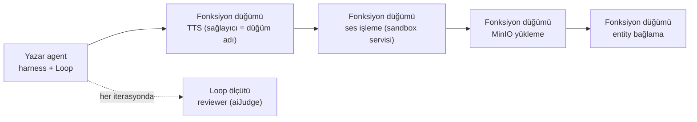

# Keşif Turu — 2026-10-11 · Podcast tüketicisi: uyum ve eksikler

> Bu bir **koşum kaydıdır**, spec değildir. Sıcak yolda değildir ve baştan sona
> okunmaz. Onaylanan kalemlerin tam metni
> [`ADAYLAR.md`](../ADAYLAR.md) içinde yaşar; bu dosya
> yalnız oraya işaret eder.

**Tetikleyen:** Bir tüketici podcast üretim hattını Tracon üzerine kurmak
istiyor: Tracon bunu karşılar mı, nasıl karşılar, eksik nedir? Kullanıcı
cevabıyla bu kayıt aynı zamanda tüketici için **iç rapordur** (cevap 9).
**Zemin:** Faz 191 kapalı, sıradaki faz planlanmadı · sıralanabilir kuyruk boş
· en büyük numara F-292.
**Ekosistem taraması:** 2026-10-11 · web erişimi var.

---

## 0. Tüketici ihtiyacı ve kullanıcı cevapları

İhtiyaç: bir agent içerik metninden iki konuşmacılı senaryo yazar; ikinci bir
agent kaliteyi denetler; ses sağlayıcısı (ElevenLabs, Gemini) sesi üretir;
Python script'leri sesi önce ve sonra işler; ses MinIO'ya yüklenir ve .NET
entity'lerine bağlanır. Talimatlar, script'ler ve TTS sağlayıcısı aktif
düzenlenir.

| # | Soru | Cevap (2026-10-11) |
|---|---|---|
| 1 | Script'leri kim yazar? | Operatör, çalışma anında |
| 2 | İnsan onayı? | Şimdilik yok. Reviewer red verirse revizyon döngüsü başlar; revizyon sayısı parametrik |
| 3 | Konuşmacı sayısı | Varsayılan: iki |
| 4 | Ön ve son işleme | Varsayılan: önce metin normalleştirme ve bölme; sonra loudness, müzik, kırpma (ffmpeg) |
| 5 | Çalışma ortamı | Linux, compose container, .NET 10 |
| 6 | TTS sağlayıcısı | Workflow başına değişir; Gemini var |
| 7 | Kiracılık | Çok kiracılı SaaS; kiracıya özel workflow; workflow'ları host yönetir |
| 8 | Hacim | Varsayılan: günde ≤20 bölüm, 10–20 dk, düz metin |
| 9 | Raporun yeri | İç kayıt; eksikler `ADAYLAR.md`'ye |

---

## 1. Ölçülen zemin (Aşama 0)

| Kaynak | Bulgu |
|---|---|
| Son fazların devir notu (189–191) | Bu alana iş bırakmamış; 191 "sıradaki faz planlanmadı" der |
| Aday dosyası | Konsol fonksiyon düğümü editörü zaten **F-292** (2026-10-10 kusur-giderme turu) |
| Önceki tüketici turu (2026-09-07) | A08'in ses notu (token dışı maliyet) bekliyor; **A17** (genel workflow motoru) mimari ret değil, "somut vaka çıkarsa" yeniden değerlendirilir |
| 2026-08-27 ses turu | B3 (kiracı ses politikası) yazılmış ama aday numarası almamış |
| Sürüm | Depo MAF 1.20.0'da; NuGet'te en yeni 1.24.0 (2026-10-11) |

---

## 2. Tasarım — Tracon bu hattı nasıl karşılar

### 2.1 Harness mı workflow mu?

**İkisi birlikte; kod grafı gerekmez.** Hat kiracı başına **veri olarak**
tanımlanır:

- Karışık bir `Sequential` workflow (`Nodes`: agent + fonksiyon düğümleri,
  Faz 71). Tanım veritabanındadır; host onu kiracı başına API'den yönetir.
- İlk düğüm yazar agent'tır. Harness `Loop` revizyon döngüsüdür: reviewer bir
  **döngü ölçütüdür** (`aiJudge`; ölçütleri ve talimatı operatör düzenler),
  revizyon sayısı `LoopSettings.MaxIterations` değeridir. Reviewer'ın geri
  bildirimi `LoopEvaluation.Continue(feedback)` ile sonraki iterasyona taşınır
  (MAF 1.24.0 probu: `LoopContext.Feedback`).
- 🚨 **Ölçülmedi — ham liste #14 ile birlikte ölçülmeli:** Tracon loop'u
  `NonStreamingReturnsLastResponseOnly = false` ile kurar
  (`LoopEvaluatorRegistry`), ve karışık zincirin agent adımı yanıtın **bütün**
  mesajlarını sonraki düğüme iletir (`WorkflowAgentStepExecutor.cs:33-42`).
  TTS düğümüne bütün taslaklar gidebilir; düğüm son asistan mesajını açıkça
  seçmelidir.
- 🚨 **Tek şart:** Loop tavana ulaşırsa ya da ölçüt hata verirse bugün son
  yanıt döner ve run başarılı biter — onaylanmamış metin TTS'e geçer. Kapanış
  **F-293**'tür. Ara çözüm: reviewer kararını yeniden denetleyip başarısızlıkta
  istisna atan bir fonksiyon düğümü.
- Ayrı bir reviewer **agent'ı** (kendi talimatı, kendi modeli, tool'ları)
  isteniyorsa ölçüt kodda yazılır ve DI ister: **F-301**.
- Genel workflow motoru (A17) **yeniden açılmadı**: koşullu dal ihtiyacı loop
  ölçütü ve F-293 ile karşılanıyor.

### 2.2 Kalite: eval yapısı

Üç katman, üç ayrı iş:

| Katman | Tracon yüzeyi | İşi |
|---|---|---|
| Üretim kapısı (engeller) | Loop ölçütü (`aiJudge` veya kodla kayıtlı tür) | Her bölümü TTS'ten önce durdurur |
| Çevrimiçi izleme (engellemez) | `IRunJudge` / `AddModelRunJudge`, örneklemeli | Kalite eğilimini izler |
| Regresyon | Eval suite'leri (`tracon eval`, CI) | Operatör talimatı değiştirince eski bölümlerle karşılaştırır |

### 2.3 Sandbox gerekli mi? — Evet, zorunlu

- Script'i operatör çalışma anında yazar (cevap 1): kod **güvenilmez** girdidir.
- K2: Tracon arayüzden yazılan kodu **çalıştırmaz**; tool kodu yalnız koddadır.
  Bu sınır gevşetilmez (ham liste #18 bu yüzden elendi).
- Skill script'leri içerik-sabitli izinle (K-860, K-861) çalışır ama **aynı
  container ve kullanıcıyla**; OS yalıtımı yoktur (K-862). Operatör koduna
  uygun değildir.
- Hyperlight (F-169) hâlâ 0.7.0 (2026-10-11): eşik aşılmadı.

### 2.4 Python nerede çalışır?

Ayrı bir compose servisi: **script-runner**.

- Çalışma zamanı gVisor (`runsc`) veya nsjail; root olmayan kullanıcı; salt
  okunur kök; iş başına `tmpfs` çalışma dizini; CPU, bellek ve süreç sınırları.
- Ağ yok; tek istisna MinIO'nun **ön imzalı** GET/PUT adresleri.
- Python sürümü, kilitli bağımlılıklar ve ffmpeg imajın içindedir.
- Script içeriğini tüketicinin .NET uygulaması saklar (sürümlü, denetimli) ve
  runner'a içerik hash'iyle verir. Fonksiyon düğümü runner'ı HTTP ile çağırır;
  ses baytı LLM bağlamına veya iş JSON'una girmez.

### 2.5 MinIO ve entity ilişkisi

- Ses tüketicinin domain varlığıdır: tüketicinin kendi bucket'ına fonksiyon
  düğümü yazar. Tracon'un `IAttachmentStorage`'ı (S3 uyumlu seam) run
  ekleri içindir; bu işe gerekmez.
- `RunId` ↔ `PodcastEpisode` bağı run etiketleri ve özel run olaylarıyla
  kurulur; idempotency (aynı bölümün iki kez yüklenmesi) tüketicinin işidir.

### 2.6 Operatöre kolaylık

| Düzenlenen | Bugün | Eksik |
|---|---|---|
| Agent talimatı | Konsol + sürüm geçmişi + geri alma | — |
| Revizyon sayısı, yargıç ölçütleri | Yalnız API | F-302 |
| Workflow zinciri | Konsolda salt okunur (2026-10-10) | F-292 |
| TTS sağlayıcısı ve ses | Düğüm adıyla, kodda | F-295, F-298 |
| Script | Tüketicinin kendi deposu + sandbox | — (bilerek Tracon dışı) |
| Workflow ve skill geçmişi | Yok | F-300 |

### 2.7 Çok kiracılık

- Workflow tanımları kiracıya özeldir; host API ile yönetir.
- Model çağrılarında kiracı egress ve BYOK uygulanır. Bu turda bulunan kusur
  (özet modeli ve loop yargıcı kapsam dışıydı) **giderildi** (K-874, § 5).
- Konuşma sağlayıcısı kiracıdan habersizdir: **F-298**.

---

## 3. Ham fikir listesi (Aşama 2)

| # | Fikir | Kim için | Neden şimdi | Sonuç |
|---|---|---|---|---|
| 1 | Loop tükenme politikası | Kalite kapısı kuran ekip | Onaylanmamış metin TTS'e geçer | ✅ F-293 |
| 2 | Workflow run parametreleri | Çok kiracılı host | Yalnız `Message` geçiyor | ✅ F-294 |
| 3 | Fonksiyon düğümü veri ayarı | Operatör | Workflow başına sağlayıcı | ✅ F-295 |
| 4 | Konuşma sözleşmesi v2 | İlk agent'ını kuran geliştirici | İki konuşmacı | ✅ F-296 |
| 5 | Gemini konuşma adaptörü | Gemini kullanan ekip | Bağımlılık hazır | ✅ F-297 |
| 6 | Adlı konuşma kaydı + ses BYOK | Kurumsal platform ekibi | Ses egress/BYOK dışında | ✅ F-298 |
| 7 | Token dışı maliyet (fonksiyon düğümü) | FinOps | TTS maliyeti kaybolur | ✅ F-299 |
| 8 | Workflow/skill sürüm geçmişi | Nöbetçi mühendis | Düzenleme geri alınamaz | ✅ F-300 |
| 9 | Tanım dışa/içe aktarma | Host, dev→prod | Kiracı kurulumu | ⏸ ertelendi |
| 10 | `AddLoopEvaluator` fabrika | MAF'ı kullanan ekip | Ölçüt DI'a ulaşamaz | ✅ F-301 |
| 11 | Konsolda `Loop` düzenleme | Operatör | Yalnız API | ✅ F-302 |
| 12 | Fonksiyon düğümü zaman aşımı | Nöbetçi mühendis | K-497 koşulu oluştu | ✅ F-303 |
| 13 | Skill script'ini harici sandbox'a yönlendiren seam | Kurumsal platform ekibi | K-862 istisnası | ⏸ ertelendi |
| 14 | Karışık zincirde mesaj aktarımı | Workflow kuran ekip | `BuildSequential` ile farkı ölçülmedi | ⏸ ölçüm bekliyor |
| 15 | Workflow içindeki agent için experiment | Ölçme–iyileştirme | — | ⏸ ertelendi |
| 16 | Workflow düzeyinde eval | Ölçme–iyileştirme | — | ⏸ ertelendi |
| 17 | Elle kurulan graf için public agent adımı executor'ı | MAF'ı kullanan ekip | — | ⏸ ertelendi |
| 18 | Operatör script'ini Tracon'un çalıştırdığı düğüm | — | — | ❌ K2 |

**Önerilen üç kalem:** 1, 2, 3 — üçü de jenerik, K2'ye uyumlu ve yüzeyleri
küçük; 1 olmadan önerilen tasarım güvenli değil.

**Kullanıcının elemesi (2026-10-11, "varsayılan, koş"):** 1–8 ve 10–12 aday
dosyasına; 9 ve 13–17 burada ertelendi; 18 reddedildi.

---

## 4. Ekosistem taraması (Aşama 3.2)

| Kaynak | Bakılan tarih | Ne gördük | Tracon'e etkisi |
|---|---|---|---|
| `Microsoft.Agents.AI` 1.24.0 (yansıma probu) | 2026-10-11 | `LoopAgentOptions` ve `LoopEvaluation`'da "tavanda düşür" yok | F-293 Tracon'da kurulur |
| Google Gemini TTS dokümanı | 2026-10-11 (sayfa 2026-10-01) | İstekte en çok 2 konuşmacı; 24 kHz mono 16-bit PCM/WAV; .NET örneği yok | F-296 yetenek bildirimi, F-297 |
| ElevenLabs Text-to-Dialogue API | 2026-10-11 | En çok 10 ses; istek başına ≤2.000 karakter; `stability`/`similarity` | F-296 bölme/birleştirme şart |
| `Google.GenAI` 1.16.0 (`maf-api-kesfi` dökümü) | 2026-10-11 | `MultiSpeakerVoiceConfig`, `SpeakerVoiceConfig`, `PrebuiltVoiceConfig` var | F-297 yeni bağımlılık istemez |
| `Hyperlight.HyperlightSandbox.Api` | 2026-10-11 | En yeni 0.7.0 | F-169 eşiği aşılmadı |

---

## 5. Üç kanalın çıktısı (Aşama 1)

### Kanal 1 — yeni aday

| F-NN | Başlık | Aday dosyasına yazıldı mı |
|---|---|---|
| F-293 | Loop tükenince veya ölçüt hata verince run düşebilsin | ✅ |
| F-294 | Workflow run parametreleri | ✅ |
| F-295 | Fonksiyon düğümüne veri ayarı | ✅ |
| F-296 | Konuşma sözleşmesi v2 | ✅ |
| F-297 | Gemini konuşma adaptörü | ✅ |
| F-298 | Adlı konuşma sağlayıcı kaydı + kiracı ses anahtarı | ✅ |
| F-299 | Fonksiyon düğümünün token dışı maliyeti | ✅ |
| F-300 | Workflow ve skill sürüm geçmişi | ✅ |
| F-301 | `AddLoopEvaluator` fabrika aşırı yüklemesi | ✅ |
| F-302 | Konsolda `Loop` düzenleme | ✅ |
| F-303 | Fonksiyon düğümü zaman aşımı | ✅ |

### Kanal 2 — kusur

| Bulgu | Kanıt | Kullanıcıya söylendi mi | `kusur-giderme` koşuldu mu |
|---|---|---|---|
| Özet modeli ve `aiJudge` yargıcı kiracı egress'ini ve BYOK'u atlıyor | Önce kod okuma (`LoopEvaluatorRegistry.cs:255`, `AgentDefinitionCompiler.Compaction.cs:196`), sonra düzeltme öncesi kırmızı testler | ✅ | ✅ 2026-10-11 — K-874, kapı `CompilePathTenantAwarenessTests` |
| Önbellekteki agent sonradan kaydedilen egress politikasını görmez | Prob testi, sonra `EgressPolicyCacheTests` (düzeltmeden önce iki kez kırmızı) | ✅ | ✅ 2026-10-11 — K-875 (seçenek A), F-304 kapandı |
| Canlı ses kiracı politikasını ve BYOK'u uygulamaz (F-304'ün sınıf taraması) | Kod okuması: `OpenAILiveProvider.cs:118,169,193-194` | ✅ | ☐ kullanıcı kararı bekliyor — **F-306** |
| Önbellekteki agent'ın MCP tool'ları sunucu değişince bayatlar (aynı tarama) | Kod okuması: `McpToolCatalog.cs:236-252` | ✅ | ☐ önce repro — **F-305** |

### Kanal 3 — yeniden açılması önerilen karar

| K-NNN | Kararın gerekçesi | Neyin değiştiği | Kullanıcının kararı |
|---|---|---|---|
| A17 (2026-09-07 turu, mimari ret değil) | Genel workflow motoru somut vaka bekler | Vaka geldi ama loop ölçütü + F-293 onu karşılıyor | Yeniden açılmadı |
| F-169 (Hyperlight) | Paket GA ve taşınabilir olmalı | Değişmedi (0.7.0) | Eşikte kalır |
| K-497 | Düğüm zaman aşımı "ihtiyaç ölçülürse" aday olur | İhtiyaç ölçüldü (dakikalar süren TTS düğümü) | Kararın kendi koşuluyla F-303 yazıldı; ret değil |

---

## 6. Reddedilenler ve ertelenenler

| Fikir | Gerekçe | Kalıcı mı | Nereye yazıldı |
|---|---|---|---|
| 18 · Operatör script'ini Tracon'un çalıştırdığı düğüm | K2: arayüzden yazılan kod çalıştırılmaz (`KARARLAR-INDEKS-REDDEDILEN` L20) | Evet | Burada; ret listesi zaten kapsıyor |
| 9 · Tanım dışa/içe aktarma | Host tanımları API ile zaten yönetiyor (cevap 7); değer ölçülmedi | Hayır | Yalnız burada |
| 13 · Harici sandbox seam'i | Operatör kodu tüketicinin runner'ında; Tracon'a yeni kod yüzeyi açmak gerekmiyor | Hayır | Yalnız burada |
| 14 · Karışık zincirde mesaj aktarımı | `BuildSequential` ile farkı ölçülmedi; kusur da çıkabilir | Hayır — ölçüm bekliyor | Yalnız burada |
| 15–17 · Workflow experiment, workflow eval, public agent adımı executor'ı | Bu tüketicide somut ihtiyaç yok | Hayır | Yalnız burada |

---

## 7. Kullanıcıya sorulanlar ve cevapları

| Soru | Cevap |
|---|---|
| § 0'daki dokuz soru | § 0 tablosu |
| Konsol `nodes` kaybı (B01 sınıfı) için kusur-giderme | "sorunu kusur gidermeyle gider" — 2026-10-10'da kapandı (K-873, F-292) |
| Ham listenin elemesi ve Kanal 2 kusuru | "varsayılan, koş" |
