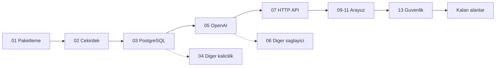

# Tracon — Manuel Kabul Testi İndeksi

> Yayın öncesi gerçek ortamda koşulan kabul testi setinin giriş noktası. Case'i
> ajan koşar; insan son çaredir
> ([kabul basamakları](../../.agents/ortak/test-seviyeleri.md)). Ortam kurulumu,
> ortak fixture verisi, reset yordamı, hata bildirim şablonu ve dosya durum
> tablosu buradadır.
>
> **Koşum protokolü bu dosyada değildir** —
> [`.agents/skills/manuel-test-kosumu/SKILL.md`](../../.agents/skills/manuel-test-kosumu/SKILL.md).
> Bu dosya turdan bağımsız **ortamı** tarif eder, koşumun kendisini değil.

---

## 1. Bu setin üç parçası

| Parça | Nerede | Ömrü |
|---|---|---|
| **Spec** — case metni (ön koşul, adımlar, beklenen sonuç) | `docs/manuel-test/<NN>-<ALAN>.md` | Kalıcı; turdan bağımsız |
| **Protokol** — nasıl koşulur, nasıl kapatılır | [`manuel-test-kosumu`](../../.agents/skills/manuel-test-kosumu/SKILL.md) skill'i | Kalıcı; her tur aynısını uygular |
| **Koşum kaydı** — `Gerçek sonuç` + `Durum` | `kosumlar/<tarih>/` (tur açılışında açılır) → kapanınca `docs/arsiv/` | Bir tura ait; donmuş (K-414) |

Üçü karışmaz. Spec dosyalarında `Durum:` satırı **yoktur**; ikinci bir tur
spec'in üzerine yazmaz, `kosumlar/` altında yeni bir tarih dizini açar.

> **Açık tur yok.** Son tur (2026-09-16) 2026-09-19'da kapandı. Kaydı
> 2026-10-17'de silindi; tam metin:
> git show 2a8149ef:docs/arsiv/manuel-test-kosum-2026-09/DEVIR.md. Bu dosya
> turdan **bağımsız** ortamı tarif eder, turun kendisini değil.

> **Şeride özgü ortam kurulumu ve reset yordamı** skill'in
> [`resources/serit-kurulumu.md`](../../.agents/skills/manuel-test-kosumu/resources/serit-kurulumu.md)
> dosyasındadır. Bu dosyanın §2 bölümü tura bağımsız ön koşulları ve fixture
> verisini tarif eder; şerit yordamlarını tekrarlamaz.

---

## 2. Ortam kurulumu

Bu bölüm bir kez uygulanır. Her senaryo dosyası buraya referans verir.

### 2.1 Ön koşullar

| Gereksinim | Sürüm | Doğrulama |
|---|---|---|
| .NET SDK | 10.0.100+ | `dotnet --version` |
| Node.js | 22.22.2+, 24.15+ veya 26+ | `node --version` |
| Docker Desktop | Çalışır durumda, 8 GB | `docker info` |
| Python | 3.10+ · `pip install openai` | `python3 -c "import openai"` |
| Chrome | Güncel | — |

**Donanım notu:** Bu makine `arm64` (Apple Silicon). `mcr.microsoft.com/mssql/server`
imajının arm64 sürümü **yoktur**. Docker Desktop → Settings → General →
*Rosetta for x86/amd64 emulation* açık olmalıdır. Açılamazsa SQL Server izleği
`azure-sql-edge` ile koşulur ve bu sapma sonuç dosyasına yazılır.

### 2.2 Veritabanı container'ları

Entegrasyon testlerinin kullandığı **aynı** imajlar kullanılır; başka bir imaj
farklı davranış üretebilir.

```bash
# PostgreSQL — pgvector uzantisi ZORUNLU (RAG izlegi icin).
docker run -d --name ap-pg -p 55432:5432 \
  -e POSTGRES_PASSWORD=tracon -e POSTGRES_DB=tracon \
  pgvector/pgvector:pg18

# SQL Server — ~2 GB bellek ister.
docker run -d --name ap-mssql -p 51433:1433 \
  -e ACCEPT_EULA=Y -e MSSQL_SA_PASSWORD='Tracon!2026' \
  mcr.microsoft.com/mssql/server:2022-latest
```

SQLite dosya tabanlıdır, container istemez.

### 2.3 Yerel NuGet feed (İzlek A)

Temiz tüketici izleği, paketleri **nuget.org'dan değil** yerel dizinden alır.

```bash
cd ~/Desktop/projects/Tracon

MSBUILDDISABLENODEREUSE=1 dotnet pack Tracon.slnx -c Release

mkdir -p ~/tracon-local-feed
find artifacts -name "*.nupkg" -exec cp {} ~/tracon-local-feed/ \;

dotnet nuget add source ~/tracon-local-feed -n tracon-local
dotnet new install Tracon.Templates::*-* --add-source ~/tracon-local-feed
```

> 🚨 `MSBUILDDISABLENODEREUSE=1` **atlanmaz.** Öksüz MSBuild düğümleri boruyu açık
> tutar ve komut dakikalarca asılı kalır (repo hafızasında ölçüldü: 8 dk+ → 18,5 sn).

Repo'nun `NuGet.config` dosyası `<clear />` içerir ve yalnız nuget.org tanımlar.
Yerel feed **repo dışında** oluşturulan tüketici projesinde kullanılır; repo'nun
`NuGet.config` dosyası değiştirilmez.

### 2.4 Secret'lar

Hiçbir değer dosyaya yazılmaz. Tümü `dotnet user-secrets` içinde yaşar.

```bash
cd samples/Tracon.Api

dotnet user-secrets set "Tracon:PostgreSql:ConnectionString" \
  "Host=localhost;Port=55432;Database=tracon;Username=postgres;Password=tracon"

dotnet user-secrets set "Tracon:Providers:OpenAI:ApiKey"    "<OPENAI_ANAHTARINIZ>"
dotnet user-secrets set "Tracon:Providers:Anthropic:ApiKey" "<ANTHROPIC_ANAHTARINIZ>"
dotnet user-secrets set "Tracon:Providers:Google:ApiKey"    "<GOOGLE_ANAHTARINIZ>"
dotnet user-secrets set "Tracon:Providers:OpenAICompatible:openrouter:ApiKey" "<OPENROUTER_ANAHTARINIZ>"
dotnet user-secrets set "Tracon:Voice:ApiKey"               "<ELEVENLABS_ANAHTARINIZ>"
dotnet user-secrets set "Tracon:Ui:AuthToken"               "manuel-test-token-2026"
```

> ### 🔧 Ortamın durumu — 2026-09-16 tazeleme turunda kuruldu ve doğrulandı
>
> `UserSecretsId` **`tracon-sample-api`**'dir. Faz 162'ye kadar
> `agentprism-sample-api` idi ve anahtarlar eski ürün adının önekini taşıyordu;
> göç bu turda yapıldı. Eski depo **silinmedi**, geri dönüş açıktır.
>
> **Tanımlı 17 anahtar** (yalnız AD — K-059 gereği hiçbir değer hiçbir dosyada
> yazılı değildir; okumak için `dotnet user-secrets list`):
> `Tracon:Providers:{OpenAI,Anthropic,Google}:ApiKey` ·
> `Tracon:Providers:OpenAICompatible:openrouter:ApiKey` · `Tracon:Voice:ApiKey` ·
> `Tracon:Voice:{DefaultVoiceId,Conversation:PersistAudio,Live:Instructions}` ·
> `Tracon:Ui:AuthToken` · `Tracon:PostgreSql:{ConnectionString,SchemaName}` ·
> `Tracon:Sqlite:ConnectionString` · `Tracon:ContentProtection:RawKeys:{sample,sample2}` ·
> `Tracon:Pricing:Currency` · `Tracon:Pricing:Voice:openai:gpt-live-1:PerMinute` ·
> `Tracon:TriggerSecrets:Slack`.
>
> **Azure kimliği YOKTUR.** `azure-support` katalogda görünmez (ölçüldü: 15
> tanımdan 14'ü çözüldü) ve `MT-MM-122` ⏭ kalır.
>
> **Container'lar §2.2'ye hizalandı.** İkisi de Faz 162 öncesinden kalmıştı ve
> eski ürün adını taşıyordu: `ap-pg`'nin veritabanı ile parolası, `ap-mssql`'in
> SA parolası. `ap-pg`'ye `tracon` veritabanı eklendi, `postgres` parolası
> §2.2'deki değere çekildi ve `vector` uzantısı kuruldu; `ap-mssql`'in SA
> parolası da §2.2'deki değere çekildi. İki container da **silinmedi**; eski
> veritabanları yerinde duruyor.
>
> 🚨 **Sağlayıcı anahtarları 2026-09-16'da düz metne çıktı ve DÖNDÜRÜLMELİDİR.**
> Tur bitince beşini de yenileyin; yenileme yalnız `user-secrets`'ı etkiler,
> hiçbir dokümanı değiştirmez.

Diğer kalıcılık sağlayıcıları **aynı anda verilmez** — biri denenirken diğerinin
kaydı silinir. Örnek uygulamanın seçim önceliği
`SqlServer > PostgreSql > Sqlite`'tır (`Program.cs:860-870`), yani ikisi birden
tanımlıysa üstteki kazanır:

```bash
dotnet user-secrets remove "Tracon:PostgreSql:ConnectionString"
dotnet user-secrets set    "Tracon:Sqlite:ConnectionString"   "Data Source=tracon-manuel.db"
dotnet user-secrets set    "Tracon:SqlServer:ConnectionString" \
  "Server=localhost,51433;Database=Tracon;User Id=sa;Password=Tracon!2026;TrustServerCertificate=true"
```

### 2.5 Uygulamayı çalıştırma

```bash
cd samples/Tracon.Api && dotnet run     # http://localhost:5080/tracon
```

Yalnız arayüz üzerinde çalışırken Vite dev sunucusu:

```bash
cd src/Tracon.UI/frontend && npm run dev   # http://localhost:5173
```

---

## 3. Ortak fixture verisi

Senaryolar bu kümeden **kimlikle** çağırır; veriyi tekrar tanımlamaz.
Bir senaryonun kendi verisi gerekiyorsa case içinde tanımlanır ve buraya girmez.

### 3.1 Örnek uygulamada hazır gelen agent'lar (İzlek B)

> 🚨 **Adlar Faz 162'de İngilizce'ye çevrildi.** Bu tablo ve case gövdeleri
> 2026-09-16 tazeleme turunda düzeltildi (294 geçiş, 17 aile). `Ad` ve
> `Görünen ad` sütunları `samples/Tracon.Api/Program.cs`'in `Name` /
> `DisplayName` satırlarından **ölçülmüştür**; elle yazılmaz.

| Ad | Görünen ad | Not |
|---|---|---|
| `support` | Support Assistant | Sipariş tool'ları bağlı |
| `researcher` | Researcher | |
| `router` | Router | |
| `summarizer` | Summarizer | MCP ve A2A ile dışa açık |
| `translator` | Translator | |
| `order-summary` | Order Summary (structured output demo) | Yapısal çıktı demosu |
| `cached-support` | Cached Support (demo) | Yanıt cache'i demosu |
| `openrouter-support` | OpenRouter Support | OpenRouter anahtarı ister |
| `claude-support` · `claude-thinking` | Claude Support · Claude Thinking | Anthropic anahtarı ister |
| `gemini-support` · `gemini-strict-filter` | Gemini Support · Gemini Strict Filter | Google anahtarı ister |
| `azure-support` | Azure Support | ⏭ Azure kimliği yok |
| `voice-assistant` | Voice Assistant | ElevenLabs anahtarı ister |
| `knowledge-assistant` | Knowledge Assistant | `pgvector` + embedding ister |

### 3.2 Örnek uygulamada hazır gelen tool'lar

> ⚠️ **Sayıyı sabitleme, varlığı denetle** — `02-CEKIRDEK-VE-KATALOG.md`'nin
> kendi kuralı. Ölçüldü 2026-09-19 (`grep -c 'TraconTool(' OrderTools.cs` +
> `Program.cs`): `OrderTools.cs`'te **8** tool, `Program.cs`'te **1** istemci
> tool'u (`read_shopping_cart`) ve ses anahtarı varsa **3** ses tool'u
> (`speak` · `transcribe` · `list_voices`) — anahtarlı kurulumda katalog
> **12**, anahtarsız **9**. `GET /api/tools` turda **10** ölçmüştü; aradaki
> iki fark `refund_order` ve `whoami`, ikisi de K-834 ile eklendi. Katalog
> ayrıca MCP keşfiyle büyür.

| Tool | İmza | Not |
|---|---|---|
| `get_order_status` | `orderId` | Sabit metin döndürür |
| `list_recent_orders` | `customerId` | `ORD-1001, ORD-1002` döndürür |
| `cancel_order` | `orderId` | **`RequiresApproval = true`** · `Effect = Destructive` · `RequiredPermission = orders.cancel` |
| `refund_order` | `orderId`, `amount` | **K-834 (2026-09-19).** `RequiresApproval = true` · `Effect = Destructive` · `RequiredPermission = orders.refund`. 🚨 Onay isteyen **ve sayısal argüman alan** tek tool — koşullu onay kuralı (`ArgumentConditions`) ancak bununla gözlemlenebilir (`MT-SEC-101`…`105`) |
| `get_slow_report` | `reportId` | `TimeoutSeconds = 1`; gövde timeout'undan uzun uyur |
| `estimate_shipping_cost` | `address` (`Street`, `City`, `PostalCode`) | Nesne argüman alan tek tool — şema iç içe bir `object` üretir |
| `mark_preview_ready` | `orderId` | Faz 141: `RunEventType.Custom` yazar (`contoso.preview-ready`) |
| `whoami` | — | **K-834 (2026-09-19).** `TraconRunContext.Current?.UserId`'yi geri okur; run atıfının tool koduna ULAŞTIĞINI gösteren tek yüzey (`MT-SEC-149`) |
| `read_shopping_cart` | — | `Program.cs`'te `AddClientTool` ile bildirilir; sunucu ÇALIŞTIRMAZ, çağrı tarayıcıya döner (Faz 61) |
| `speak` · `transcribe` · `list_voices` | — | `src/Tracon.Voice`; yalnız `Tracon:Voice` anahtarı varsa kayıtlıdır — anahtarsız kurulumda üçü de yoktur |

### 3.3 Örnek uygulamada hazır gelen workflow'lar

| Ad | Not |
|---|---|
| `summarize-and-translate` | Sıralı desen |
| `summarize-and-approve` | Human-in-the-loop |

### 3.4 Manuel testin kendi verisi

| Kimlik | Değer |
|---|---|
| `FIX-TENANT-01` | `kiraci-alfa` |
| `FIX-TENANT-02` | `kiraci-beta` |
| `FIX-AGENT-01` | Ad `manuel-destek` · Talimat `Sen bir siparis destek asistanisin. Kisa yanit ver.` · Tool `get_order_status` |
| `FIX-AGENT-02` | Ad `manuel-bos` · Talimat `Yalnizca "tamam" yaz.` · Tool yok |
| `FIX-SESSION-01` | `musteri-42` |
| `FIX-SESSION-02` | `musteri-99` |
| `FIX-PROMPT-01` | `ORD-1001 siparisim nerede?` → tool çağrısı bekler |
| `FIX-PROMPT-02` | `Merhaba` → tool çağrısı **beklemez** |
| `FIX-PROMPT-03` | `ORD-1001 siparisimi iptal et` → onay kartı bekler |
| `FIX-PROMPT-04` | 50.000 karakterlik metin → sınır senaryosu |
| `FIX-PROMPT-05` | `confidential-project hakkinda bilgi ver` → guard engellemesi bekler (2026-09-16 turunda düzeltildi: eski metin `gizli-proje` idi, `Program.cs:217`'nin `DeniedTerms`'i İngilizce `"confidential-project"` taşıyor — K-228 aynı bayatlık, MT-OAI-084'te de bulunmuştu) |
| `FIX-TOKEN-01` | `manuel-test-token-2026` (geçerli) |
| `FIX-TOKEN-02` | `yanlis-token` (geçersiz — 401 bekler) |

`FIX-PROMPT-05`, örnek uygulamadaki `AddPatternContentGuard` yapılandırmasının
`DeniedTerms` listesine dayanır.

---

## 4. Reset yordamı

Bir dosyaya başlamadan önce sistem temiz duruma alınır. Kirli durum, yanlış
"kaldı" sonucu üretir.

```bash
# 1. Uygulamayi durdur (Ctrl+C).

# 2. PostgreSQL semasini dusur — yalniz tracon semasi.
docker exec -i ap-pg psql -U postgres -d tracon \
  -c "DROP SCHEMA IF EXISTS tracon CASCADE;"

# 3. SQLite dosyasini sil.
rm -f samples/Tracon.Api/tracon-manuel.db*

# 4. SQL Server veritabanini dusur.
docker exec -i ap-mssql /opt/mssql-tools18/bin/sqlcmd -C -S localhost \
  -U sa -P 'Tracon!2026' -Q "DROP DATABASE IF EXISTS Tracon;"

# 5. Tarayici deposunu temizle: DevTools → Application → Clear site data.

# 6. Uygulamayi yeniden baslat.
cd samples/Tracon.Api && dotnet run
```

Şema düşürüldükten sonra migration'lar açılışta yeniden uygulanır
(`AutoApplyMigrations: true`). PostgreSQL'de **50 çekirdek** migration dosyası
vardır (2026-09-16 ölçümü: `src/Tracon.PostgreSql/Migrations/*.sql`); örnek
uygulamanın `appsettings.json`'ı `EnableKnowledge: true` taşır (bir
`EnableVectorSearch` agent'ı demoluyor, Faz 67), bu yüzden isteğe bağlı
"knowledge" setinin **1** migration'ı da uygulanır — açılış logunda toplam
**51** doğrulanır. 🚨 **Bu sayı her yeni migration'la artar; sabit sayıya değil
dosya sayımına bak.** Ayrıntı: [`03-KALICILIK-POSTGRESQL.md`](03-KALICILIK-POSTGRESQL.md).

---

## 5. Önem dereceleri

| Derece | Anlamı | Yayın etkisi |
|---|---|---|
| **Kritik** | Veri kaybı, `secret` sızıntısı, kiracı yalıtımının kırılması, çalışmayan çekirdek yol | Yayın **durur** |
| **Yüksek** | Bir yetenek çalışmıyor, sessiz veri bozulması, geri alınamaz yanlış etki | Yayın durur |
| **Orta** | Yetenek çalışıyor ama sınır durumunda yanlış davranıyor | Yayın notunda bilinen kusur |
| **Düşük** | Görsel, metin, kolaylık | Sonraki sürüm |

---

## 6. Hata bildirim şablonu

Bir case `Kaldı` işaretlendiğinde bu şablon doldurulur ve
`SONUCLAR-<YYYY-AA-GG>.md` dosyasına eklenir.

```markdown
### HATA-<NNN> — <kısa başlık>

- **Case:** MT-<ALAN>-<NNN>
- **Önem:** Kritik · Yüksek · Orta · Düşük
- **İzlek:** A · B · C
- **Ortam:** macOS arm64 · net10 · PostgreSQL · <sağlayıcı>

**Beklenen**
<tek cümle>

**Gerçekleşen**
<tek cümle>

**Yeniden üretme**
1. ...

**Kanıt**
- Log satırı / ekran görüntüsü yolu / HTTP yanıtı / SQL çıktısı

**Kapsam**
- Yalnız bu case mi, yoksa başka case'ler de mi etkileniyor?
```

---

## 7. Dosya durum tablosu

`Üretim` sütunu senaryonun **yazılıp yazılmadığını**, `Koşum` sütunu **son
turun** sonucunu gösterir. Üretim oturumu yalnız `Üretim` sütununa dokunur.

**Koşum sütunu — son tur: 2026-09-16.** Sayılar turun kendi kaydından
**ölçülmüştür** (`manuel-test-kosumu` skill'i §7 sayım betiği, kapanış koşumu
2026-09-19). Biçim: `✅ geçen/hedef` ve varsa `N ☒` kaldı · `N ⏭` atlandı ·
`N ☐` beklemede · `N ⬜` hiç koşulmadı. Yeni bir tur bu sütunu kendi sayımıyla
değiştirir; bir önceki turun sütunu git geçmişindedir.

**Turun toplamı:** kayıt **1.859** case taşıyor — **1.813 ☑ Geçti** ·
**26 ☐ Beklemede** · **19 ⏭ Atlandı** · **1 ☒ Kaldı**. Setin hedefi **1.867**
case'tir; aradaki **8** case hiç kayıt bloğu almadı (⬜ — §7.2 E maddesi).
🚨 Sayım betiği yalnız **blok taşıyan** case'i görür: bir case'in hiç bloğu
yoksa `İŞARETSİZ` sayısına da girmez. Turun sayımı bu yüzden `Hedef case`
sütunuyla karşılaştırılarak doğrulanır.

⚠️ **Sayımı damıtılmış kayıt üzerinde TEKRARLAMA.** Damıtma temiz geçen
case'leri tablo satırına indirir; bir case iki blok taşıyorsa (ilk deneme
ertelendi, ikincisi geçti) geriye **ilk** blok kalır ve işaretsiz görünür
(ölçüldü: 19 blok, `F-251`). Yukarıdaki sayı damıtmadan **önce** ölçülmüştür
ve bu tablonun kendisi tek kaynaktır.

**Üretim işaretleri:** ☐ beklemede · ◐ yarım · ✅ bitti

`Kaynak` sütunu, o dosyayı üretecek oturumun okuyacağı **tek** kaynak kümesidir.
Bu eşleme bir başlangıçtır; üretim oturumu grep ile doğrular ve gerekirse düzeltir.

| # | Dosya | Alan kodu | Faz | Kaynak | Hedef case | Üretim | Koşum |
|---|---|---|---|---|---|---|---|
| 01 | [`01-KURULUM-VE-PAKETLEME.md`](01-KURULUM-VE-PAKETLEME.md) | `PKG` | 0, 52, 97, 160, 182, 183, 185, 187, 188, 189, 191, 213, 214, 217, 237, 238 | `Directory.Build.props` · `Directory.Build.targets` · `src/Directory.Build.props` · `*.csproj` · `src/Tracon.Generators` · `scripts/kapi.py` (`yayin`, `test --tfm`, `paketle`, `paket-dogrula`) · `.github/workflows/ci.yml` (tek derleme zinciri, Faz 191) · `scripts/public-yuzey-envanteri.py` (Faz 182) · `scripts/sozlesme_kirilma.py` (Faz 238) · `tests/Directory.Build.props` · `samples/Tracon.Samples.Net8Consumer` (Faz 183) | **131** | ✅ | ✅ 81/81 · Faz 182: `MT-PKG-123` ✅ · `MT-PKG-124` ✅ · `MT-PKG-125` ➜ CI · Faz 183: `MT-PKG-126`…`129` ✅ · Faz 185: `MT-PKG-130`…`133` ✅ · `134` 👤 · Faz 187: `MT-PKG-135`…`141` ✅ · `142` ➜ CI · `143`, `144` ✅ · Faz 188: `MT-PKG-145`…`148` ✅ · Faz 189: `MT-PKG-149`…`152` ✅ · Faz 191: `MT-PKG-153`…`158` ✅ · `159` ➜ CI ✅ zincir (2026-09-24, `36048047050` deneme 2; iş süresi ölçümü yapılmadı) · `160` ✅ 20/20 (2026-09-24) · `100` güncellendi ✅ · kusur-giderme 2026-09-24 (A-59 · BL-058 · prova dizini): `MT-PKG-161` ✅ · `162` adım 1–2 ✅, 3–4 açık · `163` adım 1 ✅ · kusur-giderme 2026-10-11 (F-289): `MT-PKG-164` açık · Faz 213: `MT-PKG-165` ✅ (yayın provası beslemesi, 2026-10-16) · Faz 214: `MT-PKG-166` ➜ CI (`kapi.py yayin --kuru`) · Faz 217 (F-558): `MT-PKG-167`, `168` ☐ (➜ CI: `kapi.py yayin --kuru`, `release_extension_samples_test.py`) · Faz 237: `MT-PKG-169` ☐ (taban nuget.org'da yok; ➜ CI: `kapi.py yayin --kuru`), `170` ✅ · Faz 238: `MT-PKG-171` adım 1–2 ✅, adım 3 ☐ (taban nuget.org'da yok, `169` ile aynı engel), `172` ✅ |
| 02 | [`02-CEKIRDEK-VE-KATALOG.md`](02-CEKIRDEK-VE-KATALOG.md) | `CORE` | 1, 3, 72, 86, 101, 127, 130, 135, 189, 194, 201, 206, 215, 233, 234 | `src/Tracon.Core` (`Compilation/` · `Catalog/` · `Tools/` · `Sessions/`) · `src/Tracon.Abstractions` | **127** | ✅ | ✅ 96/97 · 1 ☐ (`MT-CORE-095`) · Faz 189: `MT-CORE-130` ✅ · `131` ⏳ · Faz 192: `MT-CORE-132`…`134`, `136` ✅ (canlı, `gpt-5.4-mini`) · `135` ➜ CI · kusur-giderme 2026-10-12 (F-339 · F-315): `MT-CORE-139` ☐ (➜ CI) · kusur-giderme 2026-10-12 (F-351): `MT-CORE-140` ☐ (➜ CI) · Faz 194 (F-294): `MT-CORE-141`…`142` ✅ (örnek uygulamada ölçüldü; `142` ➜ CI) · Faz 201 (F-301 · F-302): `MT-CORE-143`…`145` ✅ (örnek uygulamada ölçüldü, Echo + OpenAI) · `146` ➜ CI (`LoopEvaluatorFactoryTests`) · Faz 206 (F-247): `MT-CORE-147`…`153` ✅ (örnek uygulamada ölçüldü; `148`, `149` ➜ CI) · Faz 215 (F-568): `MT-CORE-154` ✅ (örnek uygulamada ölçüldü) · Faz 233 (F-627): `MT-CORE-155`…`156` ✅ (örnek uygulamada ölçüldü: gerçek PostgreSQL + pgvector + `gpt-5.4-mini`) · Faz 234 (F-628): `MT-CORE-157`…`159` ✅ (örnek uygulamada ölçüldü: SQLite + `gpt-5.4-mini`) |
| 03 | [`03-KALICILIK-POSTGRESQL.md`](03-KALICILIK-POSTGRESQL.md) | `PG` | 2, 51, 110 | `src/Tracon.PostgreSql` | **50** | ✅ | ✅ 50/50 |
| 04 | [`04-KALICILIK-DIGER.md`](04-KALICILIK-DIGER.md) | `SQL` | 23, 24, 110 | `src/Tracon.Sqlite` · `src/Tracon.SqlServer` · `src/Tracon.Sql.Shared` | **47** | ✅ | ✅ 44/46 · 2 ☐ (`MT-SQL-071` · `079` — 079 koşulmadı; ➜ CI) · kusur-giderme 2026-10-14 (F-430): `MT-SQL-080` ☐ (➜ CI) |
| 05 | [`05-SAGLAYICI-OPENAI.md`](05-SAGLAYICI-OPENAI.md) | `OAI` | 3, 8, 226 | `src/Tracon.OpenAI` (tümü) · devre kesici/sağlık için `src/Tracon.Core/Models/ModelProviderCircuitBreaker.cs` · `CircuitBreakingChatClient.cs` · `ModelProviderHealthCache.cs` · `ModelProviderRegistry.cs` | **44** | ✅ | ✅ 39/40 · 1 ⏭ (`MT-OAI-053`) · kusur-giderme 2026-10-12 (F-315): `MT-OAI-094` ☐ (➜ CI) · kusur-giderme 2026-10-12 (F-340): `MT-OAI-095` ☐ (➜ CI) · kusur-giderme 2026-10-12 (F-354): `MT-OAI-096` ☐ (➜ CI) · `MT-OAI-080`…`084` güncellendi (kapalı port; `404` devreye sayılmaz) · Faz 226 (F-603): `MT-OAI-097` ✅ (canlı OpenAI Responses) |
| 06 | [`06-SAGLAYICI-DIGER.md`](06-SAGLAYICI-DIGER.md) | `PROV` | 8, 26, 27, 203, 214, 217, 226 | `src/Tracon.Anthropic` · `src/Tracon.Google` · `src/Tracon.Azure` | **48** | ✅ | ✅ 30/41 · 9 ⏭ (Azure kimliği yok) · 2 ☐ (`MT-PROV-038` · `043`, Faz 204) | · Faz 203: `MT-PROV-032`…`034` beklenen metni güncellendi (ret değeri yankılanmaz), örnek uygulamada ✅ · kusur-giderme 2026-10-14 (F-426): `MT-PROV-089` ☐ (➜ CI; canlı adım gerçek anahtar ister) · Faz 214: `MT-PROV-090` ➜ CI · Faz 217 (F-558): `MT-PROV-091` ⏭ (Azure kimliği yok) · `092` ✅ (canlı Anthropic) · `093` ✅ (örnek uygulama, canlı Anthropic) · Faz 226 (F-603): `094` ✅ (canlı Anthropic) · `095` ✅ (canlı Google)
| 07 | [`07-HTTP-YONETIM-API.md`](07-HTTP-YONETIM-API.md) | `API` | 4, 34, 43, 44 | `src/Tracon.AspNetCore/Endpoints` (kısmi — bkz. dosyanın kaynak başlığı) | **43** | ✅ | ✅ 43/43 |
| 08 | [`08-OPENAI-UYUMLU-UCLAR.md`](08-OPENAI-UYUMLU-UCLAR.md) | `COMPAT` | 50, 207, 214 | `src/Tracon.AspNetCore/OpenAICompat/` (gerçek klasör adı — bkz. not) | **57** | ✅ | ✅ 50/50 · kusur-giderme 2026-10-14 (F-448): `MT-COMPAT-051` ☐ (➜ CI) · Faz 207: `MT-COMPAT-052`–`053` ✅ (2026-10-14, örnek uygulama) · kusur-giderme 2026-10-15 (F-536): `MT-COMPAT-054` ☐ (➜ CI) · Faz 214: `MT-COMPAT-055` ➜ CI · `056` ➜ CI · kusur-giderme 2026-10-19 (F-580): `MT-COMPAT-057` ☐ (➜ CI) |
| 09 | [`09-ARAYUZ-GENEL.md`](09-ARAYUZ-GENEL.md) | `UI` | 5, 30, 164, 175, 213, 216 | `src/Tracon.UI/frontend/src` (kabuk, `access-gate`, `layout`, `navigation`, `command-palette`, `router`, `i18n`, `theme`, `auth`, `shortcuts`, `ui`, `dialog`, `menu`, `tooltip`, `toolbar`, `status-dot`, `styles.css`; `settings`/`models`/`tools` ekranları yalnız genel kısım; `confirm-dialog`) | **61** | ✅ | ✅ 56/57 · 1 ☐ (`MT-UI-042`) · Faz 213: `MT-UI-058` ✅ (örnek uygulama, arayüz gömülü derleme) · Faz 216: `MT-UI-059` ✅ piksel karşılaştırması, 👤 gözle bakış açık · `060` ✅ · `061` ✅ |
| 10 | [`10-ARAYUZ-AGENT-PLAYGROUND.md`](10-ARAYUZ-AGENT-PLAYGROUND.md) | `UIAG` | 5, 19, 201, 222, 225, 228, 241 | `screens/agent*.tsx` · `playground.tsx` | **66** | ✅ | ✅ 56/58 · 2 ⏭ · Faz 201 (F-302): `MT-UIAG-059` ✅ (Playwright, OpenAI kipi) · `060`…`062` ➜ CI (Vitest; 👤 görsel kısmı bekler) · Faz 222 (F-588): `MT-UIAG-063` ✅ (Playwright, echo kipi) · Faz 228 (F-599): `MT-UIAG-065` ✅ (Playwright + gerçek OpenAI) · Faz 241 (F-544): `MT-UIAG-066` ✅ (Playwright, echo kipi) |
| 11 | [`11-ARAYUZ-RUN-SESSION-SSE.md`](11-ARAYUZ-RUN-SESSION-SSE.md) | `UIRUN` | 5, 32, 47 | `screens/run*.tsx` · `session*.tsx` · `components/cancel-run-button.tsx` · `replay-panel.tsx` · `run-comparison.tsx` · `branch-button.tsx` | **67** | ✅ | ✅ 66/66 · kusur-giderme 2026-10-12 (F-335): `MT-UIRUN-067` ☐ (➜ CI, E2E) · `MT-UIRUN-012` adım 3 eklendi |
| 12 | [`12-GOZLEMLENEBILIRLIK-MALIYET.md`](12-GOZLEMLENEBILIRLIK-MALIYET.md) | `OBS` | 6, 20, 35, 68, 89, 119, 132, 154, 173, 199, 210, 238 | `src/Tracon.Core` · `screens/dashboard.tsx` · `screens/run-detail.tsx` | **84** | ✅ | ✅ 64/65 · 1 ☐ (`MT-OBS-055`) · 1 yeni case (`MT-OBS-066`, kusur-giderme 2026-10-10) tur kaydında yok — ➜ CI (sözleşme, üç SQL) · kusur-giderme 2026-10-12 (F-349): `MT-OBS-067` ☐ (➜ CI) · kusur-giderme 2026-10-12 (F-333): `MT-OBS-068` ☐ (➜ CI) · kusur-giderme 2026-10-12 (F-366): `MT-OBS-069` ☐ (➜ CI) · Faz 199: `MT-OBS-070` · `072` · `073` koşuldu (örnek uygulama, SQLite), `071` ☐ 👤, `074` · `075` ☐ (➜ CI) · kusur-giderme 2026-10-14 (F-419): `MT-OBS-076` ☐ (➜ CI) · kusur-giderme 2026-10-14 (F-484): `MT-OBS-077` ☐ (➜ CI) · Faz 210: `MT-OBS-078` … `082` koşuldu (örnek uygulama, SQLite), `083` ☐ (➜ CI; yerel echo modeli token bildirmez) · Faz 238: `MT-OBS-084` ✅ (örnek uygulama, `dotnet-counters`; `062` ve `MT-JOB-117` beklentisi kiracı etiketinin yeni varsayılanına göre düzeltildi) |
| 13 | [`13-KIRACI-VE-GUVENLIK.md`](13-KIRACI-VE-GUVENLIK.md) | `SEC` | 6, 9, 41, 50, 53, 82, 139, 147, 148, 149, 170, 182, 208, 209, 213 | `src/Tracon.AspNetCore/Security` · `Tenancy/` · `TraconEndpointOptions.cs` · `Endpoints/ApiKeyEndpoints.cs`/`AuditEndpoints.cs`/`GovernanceEndpoints.cs` (yalnız `MapTenants`) · `Tracon.Abstractions/Security`, `Audit`, `Tenancy` · `Tracon.Core/Security`, `Audit`, `Tenancy` · `Abstractions/Runs/RunAuthorizationTypes.cs`, `Core/Runs/AllowAllRunAuthorizationHandler.cs`, `AspNetCore/RateLimiting/RunAuthorizationGate.cs` (Faz 139) · `AspNetCore/Security/SessionOwnershipGate.cs`, `Abstractions/Options/TraconSessionOwnershipOptions.cs` (Faz 148 · 149) · `Core/Diagnostics/ProductionProfileValidator.cs` + `Diagnostics/Checks/`, `AspNetCore/Tenancy/TenancyResolutionProfileCheck.cs` (Faz 170) · `Core/Audit/AuditRecorder.cs` (Faz 171) · `Abstractions/Tenancy/AmbientTenantScope.cs`, `Sql.Shared/Migrations/TenantIdCaseGuard.cs` (Faz 179) · `Core/Approvals/ToolArgumentConditionFingerprint.cs` (Faz 182) | **175** | ✅ | ✅ 143/149 · 1 ☐ (`MT-SEC-193`) · 5 ☐ (`MT-SEC-194`…`MT-SEC-198`, Faz 179 — koşulmadı) · Faz 182: `MT-SEC-199` ✅ (➜ CI) · 2026-09-23 kusur giderme: 7 ☐ (`MT-SEC-200`…`MT-SEC-206`, K-852…K-854 + yetki kapısı logu + anahtar basma — koşulmadı; ➜ CI) · Faz 190: `MT-SEC-207`…`209` ✅ (örnek uygulama) · `MT-SEC-210` ☐ (➜ CI) · `MT-SEC-091` yeniden yazıldı · 2026-10-11 kusur giderme: `MT-SEC-211` ☐ (K-874 — özet modeli ve `aiJudge` yargıcı egress; koşulmadı, ➜ CI) · `MT-SEC-212` ☐ (K-875 — politika önbellekteki agent'a ulaşır; koşulmadı, ➜ CI) · 2026-10-12 kusur giderme: `MT-SEC-213` ☐ (F-337 — workflow ve diğer run başlatan uçlarda atıf; koşulmadı, ➜ CI) · kusur-giderme 2026-10-12 (F-369): `MT-SEC-214` ☐ (➜ CI) · kusur-giderme 2026-10-13 (F-388, F-384): `MT-SEC-215`…`MT-SEC-217` ☐ (➜ CI) · kusur-giderme 2026-10-14 (F-442, F-444): `MT-SEC-218` ☐ (➜ CI) · Faz 208 (F-319): `MT-SEC-220` ✅ (örnek uygulamada ölçüldü) · `219` 👤 (denetim deposunu düşürmek) · `221` ☐ (➜ CI) · Faz 209 (F-319): `MT-SEC-222`, `223` ☐ (➜ CI) · Faz 213 (F-556): `MT-SEC-224` adım 1 ✅ (örnek uygulama), adım 2 ☐ (➜ CI) |
| 14 | [`14-SKILL-VE-SCRIPT.md`](14-SKILL-VE-SCRIPT.md) | `SKILL` | 10, 11, 186, 202, 231 | `src/Tracon.Abstractions/Skills` · `src/Tracon.Core/Skills` (tümü) · `src/Tracon.Core/Storage/InMemoryAgentSkillStore.cs`/`InMemorySkillScriptGrantStore.cs` · `src/Tracon.AspNetCore/Endpoints/SkillEndpoints.cs`/`SkillScriptGrantEndpoints.cs` · `src/Tracon.UI/frontend/src/screens/skills.tsx` | **68** | ✅ | ✅ 46/47 · 1 ⏭ (`MT-SKILL-063`) · 12 yeni case (Faz 186: `MT-SKILL-064`…`069`, `072`…`077`) tur kaydında yok — altısı faz kapanışında örnek uygulamada ölçüldü, 11'i ➜ CI · Faz 202 (F-345): `MT-SKILL-078`…`082` ✅ (örnek uygulamada ölçüldü; `078`…`080`, `082` ➜ CI) · `083` ➜ CI (disk skill'i HTTP'den çağrılamaz, F-481) · `MT-SKILL-060`/`061` beklenen metni güncellendi · kusur-giderme 2026-10-14 (F-481): `MT-SKILL-084` ☐ (➜ CI) · `083` notu güncellendi · Faz 231 (F-626): `MT-SKILL-085`, `086` ✅ (örnek uygulama, geçici SQLite, gerçek OpenAI, tarayıcıda konsol, 2026-10-21; ➜ CI: `SkillExposureTests` · `SkillReadApprovalTests` · `agent-editor.test.tsx`) |
| 15 | [`15-WORKFLOWS.md`](15-WORKFLOWS.md) | `WF` | 15, 16, 71, 87, 122, 194, 195, 196, 197, 200, 208, 209, 211, 230, 239, 240 | `src/Tracon.Workflows` · `screens/workflow*.tsx` | **141** | ✅ | ✅ 70/70 · 1 yeni case (`MT-WF-120`, kusur-giderme 2026-10-10) tur kaydında yok — örnek uygulamada ölçüldü, ➜ CI (E2E) · kusur-giderme 2026-10-12 (F-338): `MT-WF-124` ☐ (➜ CI) · kusur-giderme 2026-10-12 (F-334): `MT-WF-125` ☐ (➜ CI) · `MT-WF-114`/`118` güncellendi · kusur-giderme 2026-10-12 (F-332): `MT-WF-126` ☐ (➜ CI) · Faz 194 (F-294): `MT-WF-127`…`130` ✅ (örnek uygulamada ölçüldü) · `131` 👤 görsel · Faz 195 (F-292, F-295): `MT-WF-133`, `136`, `137` ✅ (örnek uygulamada ölçüldü) · `132`, `134`, `135` 👤 görsel (E2E ve Vitest karşılığı var) · `MT-WF-120` güncellendi · kusur-giderme 2026-10-12 (F-341): `MT-WF-138` ☐ (➜ CI) · Faz 197 (F-318): `MT-WF-139`…`141` ✅ (örnek uygulamada ölçüldü) · Faz 196 (F-303, F-405): `MT-WF-142`, `143`, `145`…`147` ✅ (örnek uygulamada ölçüldü) · `144` 👤 görsel (Vitest ve E2E karşılığı var; denetim sonrası karar 1 ile güncellendi) · kusur-giderme 2026-10-14 (F-398, F-433): `MT-WF-148`, `149` ☐ (➜ CI) · Faz 200 (F-300): `MT-WF-151`…`155` ✅ (örnek uygulamada ölçüldü: SQLite, `samples/Tracon.Api`) · `150` 👤 görsel (HTTP yarısı ölçüldü; Vitest karşılığı var) · Faz 208 (F-319): `MT-WF-157`…`159`, `162`, `164` ✅ (örnek uygulamada ölçüldü: SQLite, `samples/Tracon.Api`) · `156`, `161`, `163` 👤 görsel (HTTP yarısı ölçüldü) · `160` ☐ (➜ CI) · Faz 209 (F-319): `MT-WF-165`, `167`…`171` ✅ (örnek uygulamada ölçüldü: SQLite, `samples/Tracon.Api`) · `166` 👤 görsel (Vitest karşılığı var) · `172`, `173` ☐ (➜ CI) · `174` ✅ (örnek uygulamada ölçüldü: SQLite, satır `sqlite3` ile elle kapatıldı, yeniden başlatma) · kusur-giderme 2026-10-15 (F-536): `MT-WF-175` ☐ (➜ CI) · Faz 211 (F-537…F-539): `MT-WF-176`…`181` ✅ (örnek uygulamada ölçüldü: SQLite, `samples/Tracon.Api`, gerçek model; `178`: `kill -9` ve yeniden başlatma; `179`: yerel HTTP alıcısı) · kusur-giderme 2026-10-20 (K-1039): `MT-WF-182` ☐ (➜ CI) · Faz 230 (F-615): `MT-WF-183`…`185` ✅ (örnek uygulamada ölçüldü: SQLite, `samples/Tracon.Api`, gerçek model) · 2026-10-21 (K-1060): `MT-WF-186` ✅ (örnek uygulama, SQLite, gerçek model) · Faz 239 (F-531): `MT-WF-187`, `188` ✅ (örnek uygulamada ölçüldü: SQLite, `samples/Tracon.Api`, yerel `echo-writer-1`) · Faz 240 (F-322): `MT-WF-189`, `190` ✅ (örnek uygulamada ölçüldü: SQLite, `samples/Tracon.Api`; `190`: `kill -9` ve yeniden başlatma; `189`: konsolda `queued` rozeti Playwright MCP ile) |
| 16 | [`16-IS-KUYRUGU-VE-ZAMANLAMA.md`](16-IS-KUYRUGU-VE-ZAMANLAMA.md) | `JOB` | 17, 42, 46, 120, 194, 196, 197, 240 | `src/Tracon.Core` (job) · `screens/job*.tsx` | **119** | ✅ | ✅ 98/98 (`MT-JOB-132` kapanışta yeniden numaralandı — ID çakışması) · kusur-giderme 2026-10-12 (F-348): `MT-JOB-134` ☐ (➜ CI, zamanlamaya duyarlı) · kusur-giderme 2026-10-12 (F-352): `MT-JOB-135` ☐ (➜ CI) · Faz 194 (F-294): `MT-JOB-136`…`137` ✅ (örnek uygulamada ölçüldü) · `138`, `139` ➜ CI · kusur-giderme 2026-10-12 (F-367, F-370, F-364, F-344): `MT-JOB-140`…`143` ☐ (➜ CI) · kusur-giderme 2026-10-13 (F-385): `MT-JOB-144` ☐ (➜ CI) · Faz 197 (F-318): `MT-JOB-145` 👤 (webhook alıcısı; adım 1, 2 ve 5 örnek uygulamada ölçüldü) · Faz 196 (F-323): `MT-JOB-146`…`148` ✅ (örnek uygulamada ölçüldü) · kusur-giderme 2026-10-14 (F-391): `MT-JOB-149` ☐ (➜ CI) · kusur-giderme 2026-10-14 (F-429, F-393): `MT-JOB-150`…`151` ☐ (➜ CI) · kusur-giderme 2026-10-15 (F-547): `MT-JOB-152` ☐ (➜ CI) · Faz 240 (F-322): `MT-JOB-153` ✅ (örnek uygulamada ölçüldü: SQLite, `samples/Tracon.Api`) |
| 17 | [`17-EVAL-VE-DENEYLER.md`](17-EVAL-VE-DENEYLER.md) | `EVAL` | 18, 19, 31, 45, 49, 56, 154, 176, 227 | `src/Tracon.Abstractions/Evaluation`, `Experiments` · `src/Tracon.Core/Evaluation`, `Experiments`, `Audit/AuditingExperimentStore.cs` · `src/Tracon.AspNetCore/Endpoints/EvalEndpoints.cs`, `ExperimentEndpoints.cs`, `RunEndpoints.cs` (yalnız feedback/compare/input/replay) · `screens/eval*.tsx` · `experiment*.tsx` · `promote-to-eval-case.tsx` · `feedback-control.tsx` | **76** | ✅ | ✅ 69/69 · 1 yeni case (`MT-EVAL-102`, kusur-giderme 2026-10-10) tur kaydında yok — örnek uygulamada ölçüldü, ➜ CI (sözleşme) · kusur-giderme 2026-10-12 (F-351): `MT-EVAL-104` ☐ (➜ CI) · kusur-giderme 2026-10-12 (F-365, F-343): `MT-EVAL-105`…`106` ☐ (➜ CI) · Faz 227 (F-605): `MT-EVAL-107`…`108` ✅ (2026-10-21, örnek uygulama + gerçek OpenAI + Playwright) |
| 18 | [`18-MCP-VE-A2A.md`](18-MCP-VE-A2A.md) | `MCP` | 6, 22, 50, 89, 127, 190, 213, 214, 218, 229, 231, 235 | `src/Tracon.Mcp` · `src/Tracon.AspNetCore/McpServer` · `A2A` · `Endpoints/GovernanceEndpoints.cs` (yalnız `/api/mcp-servers/*`) | **84** | ✅ | ✅ 56/59 · 3 ☐ (`MT-MCP-058` · `067` · `069` — 069 koşulmadı; ➜ CI) · Faz 190: `MT-MCP-070`…`073`, `076`, `077` ✅ (örnek uygulama) · `074` ◐ (👤 tarayıcı tıklaması koşulmadı) · `075` ☐ (➜ CI) | · 5 yeni case (`MT-MCP-078`…`082`, kusur-giderme 2026-10-11) tur kaydında yok — ➜ CI (fonksiyonel, gerçek MCP sunucuları) · kusur-giderme 2026-10-14 (F-448): `MT-MCP-083` ☐ (➜ CI) · Faz 213 (F-555): `MT-MCP-084` adım 1 ✅ (örnek uygulama), adım 2 ☐ (➜ CI) · Faz 214: `MT-MCP-085` ➜ CI · Faz 218 (F-290): `MT-MCP-086`…`088` ✅ (örnek uygulama, SQLite, 2026-10-17; ➜ CI: üç sağlayıcının migration testi) · `089` 👤 (➜ CI: `mcp.test.tsx` + `McpTests`) · Faz 229: `MT-MCP-090` ✅ (örnek uygulama, SQLite, gerçek OpenAI, 2026-10-21; ➜ CI: `A2AConversationTests`) · kusur-giderme 2026-10-21 (MAF-KAPSAMA #45): `MT-MCP-091` ☐ (➜ CI) · Faz 231 (F-626): `MT-MCP-092` ✅ (örnek uygulama, geçici SQLite, gerçek OpenAI, 2026-10-21; ➜ CI: `A2AEndpointTests` · `McpServerEndpointTests` · `SkillExposureTests`) · Faz 235 (F-617): `MT-MCP-093` · `094` ✅ (örnek uygulama, geçici SQLite, gerçek OpenAI, yerel MRTR MCP sunucusu, 2026-10-23; ➜ CI: `McpElicitationTests` · `McpElicitationHandlerTests` · `McpElicitingToolTests`) · yeniden yazıldı: `005`, `007`, `012`, `048`, `056`, `057`, `073`
| 19 | [`19-COK-MODLULUK-VE-SES.md`](19-COK-MODLULUK-VE-SES.md) | `MM` | 14, 28, 29, 72, 88, 138, 161, 198, 203, 213, 217, 220 | `src/Tracon.Abstractions/Attachments`, `Voice` · `src/Tracon.Core/Attachments`, `Voice` · `src/Tracon.Voice` (tümü) · `src/Tracon.AspNetCore/Endpoints/AttachmentEndpoints.cs`, `VoiceEndpoints.cs` · `src/Tracon.AspNetCore/Voice/VoiceConversationEndpoint.cs`, `LiveVoiceEndpoints.cs`, `VoiceEndpointGates.cs` · `src/Tracon.OpenAI/Live` · `src/Tracon.AspNetCore/OpenAICompat/AttachmentIngestion.cs` | **113** | ✅ | ✅ 87/93 · 2 ⏭ · 4 ☐ (`MT-MM-121` 2026-09-24'te canlı yeniden koşuldu: ☑) | · 2 yeni case (`MT-MM-123`, `124`, kusur-giderme 2026-10-11) tur kaydında yok — ➜ CI (fonksiyonel) · kusur-giderme 2026-10-12 (F-336): `MT-MM-125` ☐ (➜ CI) · Faz 198: `MT-MM-126`, `127`, `129` ✅ (örnek uygulama) · `131` adım 1 ✅, adım 2 ➜ CI · `128` 👤 görsel (E2E var) · `130` ☐ (➜ CI) · Faz 203: `MT-MM-132`…`137` ✅ (örnek uygulama; `133`…`137` yerel sahte ElevenLabs ucuyla, `132` 👤 dinleme) · kusur-giderme 2026-10-14 (F-443): `MT-MM-138` ☐ (➜ CI) · kusur-giderme 2026-10-15 (F-536): `MT-MM-139` ☐ (➜ CI) · Faz 213 (F-556): `MT-MM-140` ✅ (örnek uygulama) · Faz 217 (F-558): `MT-MM-141` ✅ (`elevenlabs-kayma.py` canlı belgeye karşı)
| 20 | [`20-BELLEK-RAG-BAGLAM.md`](20-BELLEK-RAG-BAGLAM.md) | `MEM` | 13, 51 | `src/Tracon.Abstractions/Agents/{Compaction,Memory}Settings.cs` · `Knowledge/*.cs` · `src/Tracon.Core/Compilation/AgentDefinitionCompiler.cs` (bellek/sıkıştırma/vektör bağlama kısmı), `ObservedCompactionStrategy.cs` · `src/Tracon.Core/Knowledge/*.cs` · `src/Tracon.PostgreSql/MigrationsKnowledge/0001_vector.sql`, `Stores/PgVectorSearchStore.cs` · `src/Tracon.AspNetCore/Endpoints/KnowledgeEndpoints.cs`, `Contracts/KnowledgeContracts.cs` | **31** | ✅ | ✅ 31/31 |
| 21 | [`21-DAYANIKLILIK-VE-IPTAL.md`](21-DAYANIKLILIK-VE-IPTAL.md) | `RES` | 32, 54, 55, 87, 126, 144, 177, 197 (44/46/47 yalnız kesişim) | `src/Tracon.Abstractions/Runs/IRunCancellationRegistry.cs`, `RunReconciliationOptions.cs` · `src/Tracon.Abstractions/Approvals/` · `src/Tracon.Core/Recording/{RunCancellationRegistry,RunHeartbeatWriter,RunReconciliationService}.cs` · `src/Tracon.Core/Approvals/` · `src/Tracon.Core/Hosting/TraconDrainService.cs` · `src/Tracon.Core/Scheduling/RunContinuationJobHandler.cs` · `src/Tracon.AspNetCore/Endpoints/{RunEndpoints.cs (yalnız CancelRunAsync),ApprovalEndpoints.cs}` · `src/Tracon.Core/Sessions/AgentSessionManager.cs` (Faz 126: `StateSchemaVersion`/`StateMafVersion`) · `src/Tracon.Core/Graph/ChildAgentInvoker.cs`, `Compilation/AgentDefinitionCompiler.Agents.cs`, `TraconOptions.cs` (`AgentGraph.ChildDeadline`/`WaitTimeout`, Faz 144) · `screens/approvals.tsx`, `run-detail.tsx` · `src/Tracon.Testing.Contracts.Xunit/Contracts/StoreCancellationContract.cs` (Faz 177) | **60** | ✅ | ✅ 51/55 · 4 ⏭ · 1 ⬜ (`MT-RES-093` — 2026-09-24'te eklendi, tur sonrası) · `MT-RES-094` ✅ 3/3 adım (2026-10-11, F-280) · Faz 197 (F-321): `MT-RES-095`, `096` 👤 süreç durdurma (örnek uygulamada ölçüldü, karşı kontrol koşulmadı) · kusur-giderme 2026-10-14 (F-448): `MT-RES-097` ☐ (➜ CI) |
| 22 | [`22-GUARDRAIL-VE-YAPISAL-CIKTI.md`](22-GUARDRAIL-VE-YAPISAL-CIKTI.md) | `GUARD` | 38, 48, 86, 127, 131, 134, 207 | `src/Tracon.Abstractions/Guards`, `Agents/ResponseFormat.cs`, `Agents/IStructuredResponseValidator.cs` · `src/Tracon.Core/Guards` (tümü), `Compilation/AgentDefinitionCompiler.cs`, `Compilation/StructuredResponseValidatingAgent*.cs`, `Models/ModelProviderRegistry.cs` · `src/Tracon.Core/Runs/DocumentChannelMessageBuilder.cs` · `src/Tracon.AspNetCore/Endpoints/AgentEndpoints.cs` · `src/Tracon.UI/frontend/src/screens/{agent-editor,agent-detail,models,run-detail}.tsx` | **62** | ✅ | ✅ 54/59 · 5 ☐ (`MT-GUARD-095` · `106` · `110`–`112`, Faz 204) · kusur-giderme 2026-10-14 (F-350): `MT-GUARD-113` ☐ (➜ CI) · Faz 207: `MT-GUARD-114`–`115` ✅ (2026-10-14, örnek uygulama) |
| 23 | [`23-SAKLAMA-ARSIV-KOTA.md`](23-SAKLAMA-ARSIV-KOTA.md) | `RET` | 21 (yalnız kota), 25, 36, 114, 128, 146, 205, 209, 239 | `src/Tracon.Abstractions/Retention`, `Quotas`, `Runs/AgentRunBudget.cs` · `src/Tracon.Core/Retention`, `Quotas`, `Recording/RunRecordingAgent.cs`, `Models/RunBudgetChatClient.cs`, `TraconOptions.cs` (`AgentGraph.MaxDuration`) · `src/Tracon.Sql.Shared/Internal/RetentionTargetRegistry.cs` · `src/Tracon.AspNetCore/Endpoints/{Retention,Quota}Endpoints.cs` · `samples/Tracon.Api/FileSystemArchiveSink.cs` | **56** | ✅ | ✅ 45/45 · 1 yeni case (`MT-RET-077`, kusur-giderme 2026-10-10) tur kaydında yok — örnek uygulamada ölçüldü, ➜ CI (E2E) · kusur-giderme 2026-10-12 (F-332): `MT-RET-078` ☐ (➜ CI) · kusur-giderme 2026-10-12 (F-372): `MT-RET-079` ☐ (➜ CI) · kusur-giderme 2026-10-13 (F-383): `MT-RET-080` ☐ (➜ CI) · Faz 205 (F-418, F-482): `MT-RET-081` ✅ ve `MT-RET-083` ✅ örnek uygulamada koşuldu (2026-10-14), `MT-RET-082` ☐ (insan: webhook alıcısı, ➜ CI), `MT-RET-084` ☐ (➜ CI) · Faz 209 (F-319): `MT-RET-085`, `086` ☐ (➜ CI) · Faz 239 (F-529): `MT-RET-087` ✅ (örnek uygulamada ölçüldü: SQLite, `samples/Tracon.Api`, yerel `echo-writer-1`) |
| 24 | [`24-TEST-PAKETI-VE-SABLON.md`](24-TEST-PAKETI-VE-SABLON.md) | `TEST` | 37, 39, 95, 98, 99, 143, 185, 188, 215 | `src/Tracon.Testing` · `src/Tracon.Templates` · `src/Tracon.Testing.Contracts.Xunit` · `samples/Tracon.Samples.FileRunStore(.Tests)` · `tests/Tracon.Package.Tests` · `samples/Tracon.Samples.CustomModelProvider(.Tests)` | **70** | ✅ | ✅ 64/66 · 2 ⬜ (`MT-TEST-077` · `083` — 👤, kayıt bloğu yok) · Faz 185: `MT-TEST-095`…`097` ✅ · Faz 188: `MT-TEST-027` DI ile yeniden yazıldı, paketlenmiş `Tracon.Testing`'e karşı ✅ · Faz 215: `MT-TEST-098` ✅ (yerel feed'e karşı restore ölçüldü; ➜ CI `kapi_test`) |
| 25 | [`25-SAGLIK-TESHIS-OPENAPI.md`](25-SAGLIK-TESHIS-OPENAPI.md) | `DIAG` | 33, 40, 85, 122, 150, 212 | `src/Tracon.AspNetCore` (health, diagnostics, OpenAPI) · `src/Tracon.Core/Diagnostics/{SilentGapWarningService,TraconExtensionPoints,RequiredBindingValidator}.cs` | **49** | ✅ | ✅ 49/49 · `MT-DIAG-006` güncellendi (F-354: kapalı port) · Faz 212: `MT-DIAG-066`…`069` ✅ (örnek uygulama + yeniden üretim + paketlenmiş tüketici) |
| 26 | [`26-ISTEMCI-TOOLLARI-VE-GOMULEBILIR.md`](26-ISTEMCI-TOOLLARI-VE-GOMULEBILIR.md) | `IST` | 61, 112, 236 | `src/Tracon.Core/Tools/TraconClientToolExtensions.cs` · `src/Tracon.AspNetCore/Internal/{ClientToolResultResolver,TraconCorsMiddleware}.cs` · `Endpoints/AgentEndpoints.cs` (`toolResults`) · `TraconEndpointOptions.cs` (`AllowedOrigins`) · `src/Tracon.UI/frontend/src/embed/` · `src/Tracon.AGUI/` | **20** | ✅ | ✅ 16/16 · Faz 236: `MT-IST-017`…`020` ✅ (örnek uygulamada ölçüldü: `@ag-ui/client` 1.0.3 + `gpt-5.4-mini`) |
| 27 | [`27-MODEL-YEDEK-VE-ON-UCUS.md`](27-MODEL-YEDEK-VE-ON-UCUS.md) | `MYU` | 62 · 81 · 113 · 124 | `src/Tracon.Abstractions/Agents/{ModelBinding,ModelFallback,ResponseCacheSettings}.cs` · `Options/{TraconPreflightOptions,TraconModelConcurrencyOptions}.cs` · `src/Tracon.Core/Models/{FallbackChatClient,ProviderConcurrencyLimiter,ContextWindowEstimator,TraconResponseCachingChatClient,ModelProviderRegistry}.cs` · `Replay/RecordedToolPlayback.cs` · `Compilation/AgentDefinitionCompiler.cs` (yalnız `BuildContextWindowStrategy`) · `src/Tracon.AspNetCore/Endpoints/AgentEndpoints.cs` (yalnız `EstimateAsync`) · `RateLimiting/PreflightGate.cs` | **19** | ✅ | ✅ 17/17 · kusur-giderme 2026-10-12 (F-338): `MT-MYU-018` ☐ (➜ CI) · kusur-giderme 2026-10-12 (F-360): `MT-MYU-019` ☐ (➜ CI) · `MT-MYU-018` güncellendi |
| 28 | [`28-DENETIM-ZINCIRI-VE-VERI-HAKLARI.md`](28-DENETIM-ZINCIRI-VE-VERI-HAKLARI.md) | `DVR` | 64 | `src/Tracon.Abstractions/Audit`, `Privacy` · `src/Tracon.Core/Audit/{AuditChainHasher,AuditChainWalker}.cs`, `Privacy/NullDataSubjectStore.cs` · `src/Tracon.Sql.Shared/Stores/{SqlAuditLog,SqlDataSubjectStore}.cs`, `Internal/DataSubjectTargetRegistry.cs` · `src/Tracon.AspNetCore/Endpoints/{AuditEndpoints,DataSubjectEndpoints}.cs` | **12** | ✅ | ✅ 10/10 · kusur-giderme 2026-10-12 (F-332): `MT-DVR-011` ☐ (➜ CI) · kusur-giderme 2026-10-12 (F-371): `MT-DVR-012` ☐ (➜ CI) |
| 29 | [`29-AGENT-DESTEGI.md`](29-AGENT-DESTEGI.md) | `AGD` | 73 | `src/Tracon.Cli/Commands/{AgentSkillCommand,GateSkillText}.cs` · `src/Tracon.Generators/{TraconUsageAnalyzer,UsageDiagnostics}.cs` · `src/Tracon.Core/buildTransitive/` · `src/Tracon.Templates/content/Tracon.Starter/Tracon.Starter.csproj` · `docs-site/scripts/build-agent-map.mjs` · `docs-site/src/content/docs/capabilities.md` · `tests/Tracon.Core.UnitTests/Architecture/CapabilityCoverageTests.cs` | **24** | ✅ | ✅ 22/24 · 2 ☐ (`MT-AGD-018` · `024`) |
| 30 | [`30-YEREL-REFERANS.md`](30-YEREL-REFERANS.md) | `YRF` | 74 · 78 | `src/Tracon.Core/buildTransitive/Tracon.Core.targets` · `src/Tracon.AspNetCore/buildTransitive/Tracon.AspNetCore.targets` · `src/Tracon.AspNetCore/Tracon.AspNetCore.csproj` (OpenAPI paketlemesi) · `src/Tracon.Templates/content/Tracon.Starter/.gitignore` · `docs-site/scripts/build-agent-map.mjs` · `tests/Tracon.Core.UnitTests/Architecture/{CapabilityEntryPoints,CapabilityExampleTests}.cs` · `src/Tracon.Generators/UsageDiagnostics.cs` (`TRC0402`) | **27** | ✅ | ✅ 25/27 · 2 ☐ (`MT-YRF-026` · `027`) |
| 31 | [`31-DOKUMAN-DOGRULUGU.md`](31-DOKUMAN-DOGRULUGU.md) | `DDG` | 75, 79, 104, 172 | `tests/Tracon.Core.UnitTests/Architecture/ShippedDocumentationSelfContainmentTests.cs` · `docs-site/scripts/check-content.mjs` · `docs-site/scripts/build-agent-map.mjs` · `docs-site/scripts/{build-api-reference,build-http-api}.mjs` · `tests/Tracon.Ui.E2ETests/DocumentationScreenshotTests.cs` · `README.md` · `src/*/README.md` · `docs-site/site.config.mjs` | **35** | ✅ | ✅ 32/35 · 3 ☐ (`MT-DDG-007` · `017` · `018`) |
| 32 | [`32-DOKUMAN-KALITESI.md`](32-DOKUMAN-KALITESI.md) | `DKL` | 76, 158, 163, 216 | `docs-site/src/styles/site.css` · `docs-site/astro.config.mjs` · `docs-site/src/sidebar.mjs` · `docs-site/src/starlightRouteData.mjs` · `docs-site/scripts/check-content.mjs` · `docs-site/scripts/check-weight.mjs` · `docs-site/scripts/build-social-images.mjs` · `docs-site/scripts/check-console-screens.mjs` · `docs-site/src/components/` · `docs-site/src/styles/landing.css` · `assets/tracon-mark.svg` · `tests/Tracon.AspNetCore.FunctionalTests/DocumentedPolicyTests.cs` | **42** | ✅ | ✅ 37/42 · 5 ☐ (`MT-DKL-001`…`004` · `006`) · Faz 216: `041` · `042` ✅ |
| 33 | [`33-DOKUMAN-KAPILARI.md`](33-DOKUMAN-KAPILARI.md) | `DKP` | 80, 90, 167, 174 | `scripts/dokuman-bakim.py` · `scripts/dokuman_bakim_test.py` · `.github/workflows/ci.yml` · `docs-site/scripts/check-capacity-stamp.mjs` | **27** | ✅ | ✅ 25/27 · 2 ☐ (`MT-DKP-026` · `027` — koşulmadı; ➜ CI) |
| 34 | [`34-ISTEMCI-VE-CLI.md`](34-ISTEMCI-VE-CLI.md) | `CLI` | 83, 115, 153, 156, 159 | `src/Tracon.Client` · `src/Tracon.Cli` · `nswag.json` · `scripts/nswag-*.py` | **46** | ✅ | ✅ 42/46 · 4 ⬜ (`MT-CLI-012` · `022` · `037` · `046` — 👤, kayıt bloğu yok) |
| 35 | [`35-TYPESCRIPT-ISTEMCISI.md`](35-TYPESCRIPT-ISTEMCISI.md) | `TSC` | 84, 216 | `packages/tracon-client` · `src/Tracon.UI/frontend/src/lib/{api.ts,server-types.ts}` · `src/Tracon.UI/Tracon.UI.Frontend.targets` · `.github/workflows/ci.yml` | **12** | ✅ | ✅ 10/12 · 2 ⬜ (`MT-TSC-008` · `009` — 👤, npm kapsamı rezerve değil) · Faz 216: `MT-TSC-012` ✅ |
| 36 | [`36-GELISTIRME-KAPILARI.md`](36-GELISTIRME-KAPILARI.md) | `GDK` | 91, 92, 116, 166, 167, 168, 169, 180, 184, 215 | `scripts/kapi.py` · `scripts/capacity.py` · `scripts/denetim-paketi.py` · `scripts/*_test.py` · `src/Tracon.UI/Tracon.UI.Frontend.targets` · `docfx/docfx.json` · `DocfxConfigurationTests.cs` · `CanaryEvaluationServiceTests.cs` · `RunReconciliationTests.cs` · `bench/Tracon.Benchmarks/` · `bench/capacity/` · `.agents/ortak/kurtarma.md` · `scripts/dokuman-bakim.py` · `scripts/manuel-test-tazelik.py` (Faz 180) · `WaitUntil.cs` · `TestDelayClassificationTests.cs` · `Tracon.Ui.E2ETests/Ui/` (Faz 184) | **60** | ✅ | ✅ 47/48 · 1 ☐ (`MT-GDK-024`) · kusur-giderme 2026-10-14 (F-356): `MT-GDK-056` ☐ (➜ CI) · Faz 215: `MT-GDK-057`…`059` ✅ (kapı ve eski bayraklar ölçüldü; `054` yeni komutla yeniden yazıldı) · `060` ➜ CI |

### 7.2 Açık kalemler — 2026-09-16 turundan devreden

> **2026-10-17 kuralı — insan son çaredir.** A, B, C ve E listelerindeki her
> case ile aile tablosundaki `👤 görsel` ve `👤 dinleme` notları bir sonraki
> turda önce ajan araçlarıyla denenir
> ([kabul basamakları](../../.agents/ortak/test-seviyeleri.md)). Bir case ancak
> denenen araç ve neden yetmediği yazılınca 👤 kalır.

Tur kapandı: **1.813 case geçti**, 1 `Kaldı`, 19 `Atlandı`. Aşağıdaki **26**
case koşulamadı ve gerekçesiyle devreder; ayrıca **8** case hiç kayıt bloğu
almadı (E maddesi). Kaynak: turun kapanış kaydı,
git show 2a8149ef:docs/arsiv/manuel-test-kosum-2026-09/KAPANIS-PLANI.md
§5 ve her case'in kendi koşum kaydı.

**A. İnsan gözü gerekiyor — tipografi, görsel doğruluk, iki dil** (10)

| Case | Dosya | Neden açık |
|---|---|---|
| `MT-DKL-001` · `002` · `003` · `004` · `006` | 32 | Tipografi/hizalama yargısı — ölçülebilir bir iddia değil |
| `MT-DDG-007` · `017` · `018` | 31 | Üretilen görsel/diyagramın **anlattığının** doğruluğu |
| `MT-GUARD-095` · `106` | 22 | Olay ve onarım metinlerinin iki dilde görsel doğruluğu |

**B. Fiziksel kaynak ya da dış ortam gerekiyor** (9)

| Case | Dosya | Neden açık |
|---|---|---|
| `MT-MM-086` · `087` | 19 | Ölçüldü: konuşma paneli `MediaRecorder` kullanıyor ve bu tarayıcıda **sentetik** bir `MediaStream`'den veri üretmiyor (giden çerçeve `2`, ses parçası `0`). Gerçek bir insanın mikrofona konuşması şart. ⚠️ Canlı ses yolu (`MT-MM-110…118`) aynı yordamla **koştu** — sınır yalnız `MediaRecorder`'da |
| `MT-SQL-071` | 04 | Ölçüldü: `chmod` çalışan sürece etki etmiyor (izin `open()` anında denetlenir) ve yazmalar WAL'a gidiyor. **Salt-okunur remount** gerekir |
| `MT-UI-042` | 09 | Gerçek WebKit/Safari motoru — bu kurulum yalnız Chromium sağlıyor |
| `MT-MCP-058` | 18 | Erişilebilir gerçek bir **iç ağ** MCP sunucusu |
| `MT-MCP-067` | 18 | Gerçek zaman aralığı — `TaskTimeToLive` dolana kadar bekleme |
| `MT-YRF-026` · `027` | 30 | Dış tüketici deposu bu ortamda yok |
| `MT-GDK-024` | 36 | İkinci bir işletim sistemi (Linux CI'da `kapi.py performans --guncelle`) |

**C. İzole bir agent/CLI koşumu gerekiyor** (2)

| Case | Dosya | Neden açık |
|---|---|---|
| `MT-AGD-018` | 29 | Taze bağlamlı bir kod agent'ına yalnız yayımlanmış `guides/embedding.md` verilerek ölçüm |
| `MT-AGD-024` | 29 | Gerçek `claude` CLI (`--output-format stream-json`) izole bir proje kökünde |

**D. Kullanıcı kararı bekliyor — sevk edilen koda ekleme ister** (5)

| Case | Dosya | Ne gerekiyor |
|---|---|---|
| `MT-CORE-095` | 02 | Kiracıya duyarlı örnek bir `IAgentSource` — bu depoda **yok**. Aday olarak kaydedildi: [`ADAYLAR.md` F-250](../ADAYLAR.md) |
| `MT-SEC-193` | 13 | Bir `IDataSubjectResolver` uygulaması. K-834'ün diğer kancalarından farklı: var olan bir anahtarı çevirmek değil, bir **alan eşlemesi** uydurmak demek. Ucun kendi cümlesi: *"Tracon does not store personal identity"* |
| `MT-MM-097` | 19 | `UriContent` dönen bir test adapter'ı — sevk edilen üç adapter'ın **hiçbiri** `UriContent` döndürmüyor (üçü de `DataContent`) |
| `MT-MM-098` | 19 | **Adım 1 GEÇTİ** (adapter `WIDTHxHEIGHT`'ı tahmin etmiyor). Adım 2 **K-835** ile bloklu |
| `MT-OBS-055` | 12 | Tetikleyici yeniden tasarlanmalı: uzun `sessionId` **üç sağlayıcıda da** çalışmıyor (ölçüldü). İş **çalışırken** oturum deposunu **yabancı** bir istisnayla düşüren bir yol gerekir |

**E. Kayıt bloğu hiç açılmadı — sayım betiğinin göremediği 8 case** (2026-09-19
kapanış ölçümü)

Bu case'ler ne `Beklemede` ne `İŞARETSİZ` sayıldı: kayıtta **blokları yok**.
Ölçüm `Hedef case` sütunuyla kaydı karşılaştırarak bulundu. Sekizinin de
gerekçesi turun kaydında yazılıdır; hiçbiri sessizce atlanmadı.

| Case | Dosya | Neden blok yok |
|---|---|---|
| `MT-TEST-077` · `083` | 24 | 👤 Yayınlanan siteyi tarayıcıda gözle inceleme |
| `MT-CLI-012` · `022` · `037` · `046` | 34 | 👤 IntelliSense gözlemi · gerçek `Ctrl+C` · site sayfası okuma · tarayıcıda `readSse` |
| `MT-TSC-008` · `009` | 35 | 👤 `@tracon` npm kapsamı **rezerve değil** — ön koşul karşılanmıyor (kullanıcı kararı) |

🚨 **Aynı ölçüm iki case'i KAPATTI.** `MT-SEC-180` ve `MT-SEC-181` de blok
taşımıyordu, ikisi de `İnsan gerekir: Hayır` diyor. 2026-09-19'da canlı
koşuldular ve **geçtiler**: 180 K-834'ün `deny-all` kancasıyla kod
değişikliği olmadan, 181 için aynı karar uyarınca üçüncü bir kalıcı demo
kancası eklendi (`Tracon:Demo:MapOpenAIConversations`).

**Tek `☒ Kaldı` case:** `MT-MM-121` — ürün kusuru, **K-835** olarak kodlandı
(`Tracon.Google`'ın görsel yolu artık sunulmayan Imagen `:predict` uç noktasını
hedefliyor). Düzeltme kullanıcı kararına bırakıldı.

**`⏭ Atlandı` 19 case:** Azure kimliği bu ortamda yoktur (§3.1) — kusur
değildir. `MT-MM-122` bu turda listeye eklendi.

### Önerilen koşum sırası

Üretim sırası yukarıdaki numaralandırmadır. **Koşum** sırası farklıdır; bağımlılık
zincirine göre gider:



`01 → 02 → 03 → 05 → 07` zinciri kırılırsa sonraki hiçbir dosya anlamlı sonuç
vermez. Bu beş dosya **kapı**dır.

---

## 8. Üretim sırasında düşen notlar

Üretim oturumları koddaki şüpheli bulguları buraya yazar. Burası bir kusur listesi
değildir — koşum aşamasında doğrulanacak **şüphelerdir**.

> 2026-10-17: Ağustos üretim notları (sonradan düşülen işaretleriyle) ve
> 2026-09-16 tazelemesinin kapanan maddeleri silindi. Notlar 2026-08-10 inceleme
> turunda tek tek işlenmişti; sonra iki tam tur koştu. Tam metin: `git show 55584bb6:docs/manuel-test/00-INDEKS.md` §8.
> Aile dosyalarındaki "eski `00-INDEKS.md` §8, `55584bb6`" atıfları bu sürümü gösterir.

> ## 🔧 2026-09-16 tazelemesinden açık kalan
>
> **Açık kalem — 🟡 `Faz` listeleri çelişiyor (36 ailenin 21'inde).** Aile
> dosyasının `**Faz:**` başlığı ile bu dosyanın §7 `Faz` sütunu birbirini
> tutmuyor ve sapma **iki yönlü**: ör. 17-EVAL başlıkta `100, 103, 118, 152,
> 153, 155` yazıyor, indekste yok; 16-JOB başlıkta `66, 129, 137` yazıyor,
> indekste yok; 02-CORE'da indekste `86`, başlıkta `106` var. Sebep tek: iki
> liste elle tutuluyor ve hiçbir kapı ikisini karşılaştırmıyor.
> `manuel_test_sayim_kaymasi` yalnız **sayıyı** ölçer.
>
> Bu turda yalnız **kanıtlanan** üç ekleme yapıldı (176→17, 172→31, 88→19);
> kalan 21 aile **uzlaştırılmadı**. Gerekçe: iki tarafta da açıklama metni var
> (`87 (yalnız düğüm başına retry)`, `44/46/47 yalnız kesişim`) ve sayıları
> prose'dan ayrıştıran bir kapı güvenilir olmaz — yanlış kapı, kapısızlıktan
> beterdir (Faz 80'in "kapı sessizce geçer" sınıfı). Kalıcı çözüm §7'nin `Faz`
> sütununu aile başlıklarından **üretmektir**; bir faz adayı olarak açılmalıdır.

---

## 9. Devir şablonu — bir case'in üç olası kaderi

> Faz 180. Bu set CI'da koşmaz ve tam bir tur üç gün sürer. Şablon o turu
> kısaltmaz; **hangi case'in artık elle koşulması gerekmediğini** tek bir
> okunabilir işarete bağlar.

Şablon uygulanınca her `MT-*` case'i dört sınıftan birine düşer ve sınıfı
**spec satırında görünür** olur:

| Sınıf | İşaret | Kural |
|---|---|---|
| **Devredildi** | ➜ CI: `Sınıf.Test` | Davranış [test seviyeleri tablosuna](../../.agents/ortak/test-seviyeleri.md) göre **doğru seviyede** otomatikleşti. Bir case'in mevcut bir testi göstermesi de bu sınıftır — devir yeni test yazmayı gerektirmez |
| **Ajan koşar** | `🤖 ajan koşar — <araç>` | Gerçek ortam ya da yargı ister ve ajanın aracı yeter: gerçek sağlayıcı, gerçek tarayıcı, görsel ya da model kalitesi yargısı. Araç **tek cümle** |
| **İnsan gerekir** | `👤 insan gerekir — <denenen araç> · <neden yetmedi>` | **Son çare.** Ajan [kabul basamaklarındaki](../../.agents/ortak/test-seviyeleri.md) yolları denedi ve yetmedi. Sebep denenen aracı adlandırır |
| **İşaretsiz** | (işaret yok) | Henüz yargılanmadı. Bir kusur değildir; dilim planlama girdisidir |

İki işaret birlikte yazılırsa `➜ CI:` kazanır, sonra `👤` gelir: bir adımı
insan isteyen case insanın listesine girmelidir.

**Yeni case kuralı (2026-10-17, kullanıcı kararı).** Bir faz sete yalnız 🤖 ya
da 👤 case ekler. Kodla tekrarlanabilir davranış otomatik teste yazılır ve sete
hiç girmez — devredilecek case üretmek, devri baştan yapmaktan pahalıdır. 🤖
case'i ekleyen faz onu kapanışta koşar.

**Case spec'ten SİLİNMEZ.** Davranışın tanımı spec'te, kanıtı CI'da durur;
işaret tek yönlü gösterir. Silmek, testin adı değiştiğinde davranışın tarifini
de kaybetmek olurdu.

### İşaretin yeri

Başlık biçimli ailelerde (01–30) işaret, case'in üstbilgi tablosuna **kendi
satırı** olarak girer — `**İlgili karar**`'dan hemen sonra:

```markdown
| **İlgili karar** | K-296 |
| **Devir** | ➜ CI: `AgentCrudTests.Delete_removes_the_definition` |
```

Bir case birden çok testi gösterebilir; ayırıcı ` · `'dır. Tablo biçimli
ailelerde (31–36) tabloya bir `Devir` **sütunu** eklenir ve işaret o hücrede
yaşar.

🚨 **İşaretin TEK evi vardır** — `Devir` satırı ya da `Devir` sütunu. Case
gövdesinin başka bir yerinde geçen bir `👤` cümlesi (ön koşul metni gibi)
işaret **değildir** ve sayıma girmez. Tek ev olmasaydı sayım, hiç
devredilmemiş ailelerde bile "manuel" üretirdi (ölçüldü: dört ailede yedi
sahte kalem).

🚨 **Hedef backtick içinde yazılır.** Backtick'siz bir hedef doğrulanamaz ve
sayaç o case'i devredilmiş **saymaz** — kanıtsız bir case'in kanıtlı görünmesi
bu sayımın tek yalan söyleyebileceği yerdir.

**İşaret imzadan düşer.** Bir case'i işaretlemek onun davranışını
değiştirmez, bu yüzden tazelik ölçümünde `değişti` üretmez — `Devir` satırı da,
`Devir` sütunu da imza hesaplanmadan önce çıkarılır. Ölçüldü: bu fazın 43
işareti `0` sahte `değişti` üretti.

### Seviye kuralı devrin ön koşuludur

Bir davranış **sınır** geçiyorsa (DI · HTTP · kiracı · akış · depo · paket)
birim testine devredilemez. Yeşil bir birim testi o sınırın çalıştığını
kanıtlamaz; yanlış seviyeye devretmek, test **yokken** yanlış bir güven üretir.
Tek kaynak: [`test-seviyeleri.md`](../../.agents/ortak/test-seviyeleri.md).

### Sayaç

```bash
python3 scripts/manuel-test-tazelik.py            # yalnız devir ölçümü
python3 scripts/manuel-test-tazelik.py --taban <commit>   # tazelik + devir
```

Tabansız mod dosya yazmaz, aile başına `devredildi / manuel / işaretsiz` basar.
Her `➜ CI:` hedefinin gerçekten var olduğu doğrulanır: **bayat işaret
kırmızıdır** (çıkış `1`). Çözülemeyen bir kaynak yolu yalnız uyarıyken bayat
işaretin kırmızı olması bilinçlidir — biri ölçümü kabalaştırır, öteki kanıtsız
bir case'i kanıtlıymış gibi gösterir.

`işaretsiz` sayısı bir **kapı değildir**. "İşaretsiz azalmalı" kuralı ancak
yeterli dilim ölçüldükten sonra ayrı bir kararla bağlanır; bugün cırcır
kurmak, yargılanmamış case'leri gelişigüzel işaretlemeye davet ederdi.

### Devredilen dilimler

| Aile | Faz | devredildi | manuel | işaretsiz | yeni/genişletilmiş test | mevcut teste işaret |
|---|---|---|---|---|---|---|
| [`07-HTTP-YONETIM-API.md`](07-HTTP-YONETIM-API.md) | 180 | 42 | 1 | 0 | 12 case | 30 case |

Devredilen 42 case **51 benzersiz testi** gösterir ve hepsi
`Tracon.AspNetCore.FunctionalTests` altındadır — HTTP sınırı geçen hiçbir
davranış birim testine devredilmedi.
